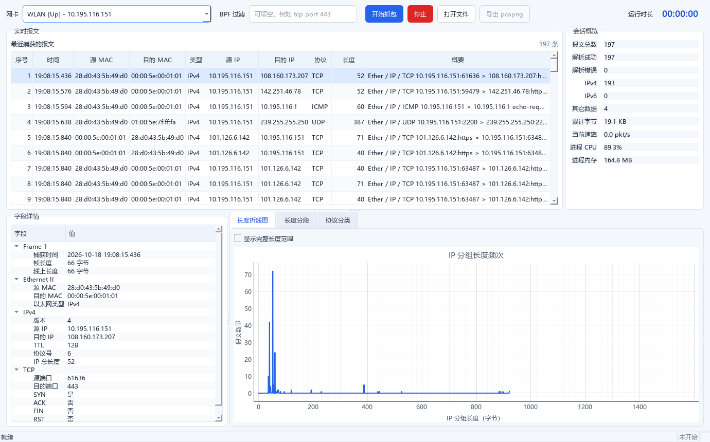

# 计算机网络课程设计：网络流量分析系统

课程设计选题：2.2 网络流量分析系统。

小组：4 人，成员 A、B、C、D，A 任组长。



## 分工

| 成员 | 主要职责 | 工作量 |
| --- | --- | --- |
| A（组长） | 架构、抓包解析、集成、打包、最终验收 | 30% |
| B | GUI、表格、字段详情、图表和交互 | 25% |
| C | 统计、持久化、资源日志和单元测试 | 25% |
| D | 测试、长稳、资源分析、测试记录和 PPT 初稿 | 20% |

详细交付物和验收标准见 [分工与任务书信息](docs/04_分工与任务书.md)。

## 文档

- [课程设计要求摘要](课程设计要求摘要.md)
- [课程设计要求全文备份](计算机网络课程设计_要求_20261016.md)
- [需求分析](docs/01_需求分析.md)
- [总体技术方案](docs/02_总体技术方案.md)
- [实现与测试记录](docs/03_实现与测试记录.md)
- [分工与任务书信息](docs/04_分工与任务书.md)

## 本机环境

- Windows 11 64 位
- Python 3.14.7
- Npcap 1.10.4
- PySide6-Essentials、pyqtgraph、Scapy、psutil、pytest、PyInstaller

项目虚拟环境位于 `.venv`。Windows 侧使用：

```powershell
E:\CN_work\.venv\Scripts\python.exe
```

启动程序：

```powershell
.\run.bat
```

如需查看控制台错误，运行 `.\run_console.bat`。

运行测试：

```powershell
.\test.bat
```

环境核查：

```powershell
E:\CN_work\.venv\Scripts\python.exe tools\check_environment.py
```

真实网卡抓包冒烟测试：

```powershell
E:\CN_work\.venv\Scripts\python.exe tools\capture_smoke_test.py
```

## 当前功能

- 网卡枚举与选择；
- 实时抓包和报文列表；
- Ethernet、IPv4/IPv6、TCP/UDP 字段展示；
- IP 长度频次折线图；
- 长度分段和 IPv4/IPv6/其它数据柱状图；
- pcapng 分段记录、单文件导出和回读；
- 运行时长和资源 CSV 日志；
- PyInstaller Windows 可执行程序。

当前自动化测试：`20 passed`。

打包产物：

```text
dist\NetworkTrafficAnalyzer\NetworkTrafficAnalyzer.exe
```

重新打包用 `.\build.bat`，直接运行打包程序用 `.\run_exe.bat`。

实现与验证详情见 [实现与测试记录](docs/03_实现与测试记录.md)。

尚未完成：正式 24 小时连续运行、异常流量检测、课程报告和 PPT。
