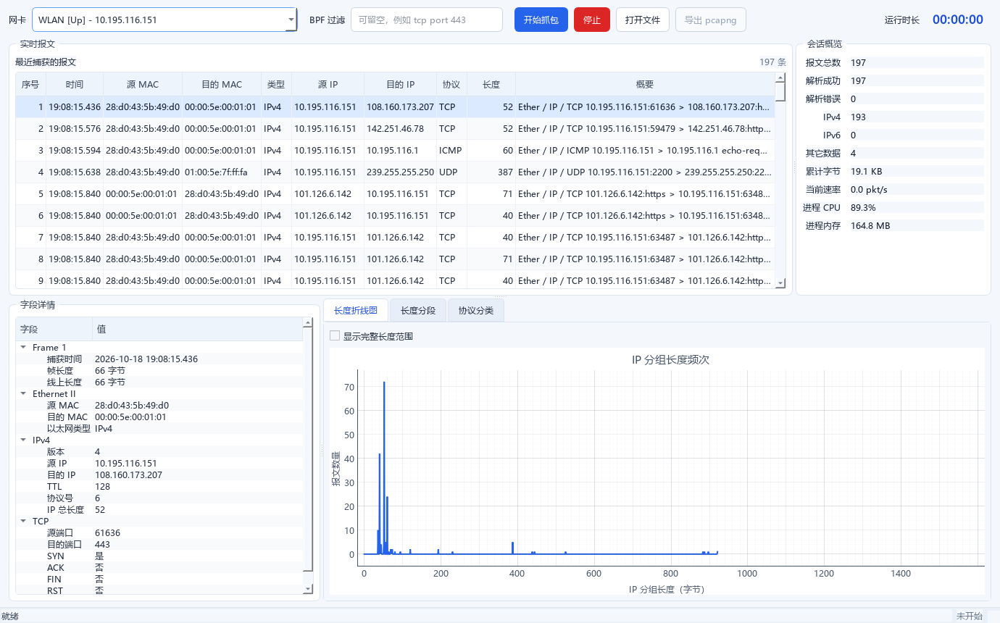

# FlowLens 流镜：网络流量分析系统

计算机网络课程设计选题 2：网络流量分析系统。项目名 FlowLens 流镜。

小组：4 人，成员 A、B、C、D，A 任组长。成员姓名与学号见 [分工与任务书信息](docs/04_分工与任务书.md)。



## 分工

| 成员 | 主要职责 | 工作量 |
| --- | --- | --- |
| A（组长） | 网络分层与字段口径、抓包解析、集成、打包、最终验收 | 25% |
| B | 协议字段语义、报文表、字段详情、图表和交互 | 25% |
| C | IP 长度/MTU/分片、协议统计、持久化、异常分析 | 25% |
| D | 协议一致性测试、真实流量验证、24 小时长稳和测试记录 | 25% |

详细交付物和验收标准见 [分工与任务书信息](docs/04_分工与任务书.md)。

## 文档

- [课程设计要求摘要](课程设计要求摘要.md)
- [课程设计要求全文备份](计算机网络课程设计_要求_20261016.md)
- [需求分析](docs/01_需求分析.md)
- [架构与后续工作](docs/02_总体技术方案.md)
- [实现与测试记录](docs/03_实现与测试记录.md)
- [分工与任务书信息](docs/04_分工与任务书.md)
- [课程设计报告](docs/FlowLens课程设计报告.docx)（正文源文件 `docs/report_draft.md`）
- [使用手册](docs/FlowLens使用手册.docx)（源文件 `docs/manual.md`）
- [答辩 PPT](docs/FlowLens答辩.pptx)
- [报告图与 draw.io 源文件](docs/figures/)

## 本机环境

- Windows 11 64 位
- Python 3.14.7
- Npcap 1.10.4
- PySide6-Essentials、pyqtgraph、Scapy、psutil、pytest、PyInstaller

项目虚拟环境位于 `.venv`。Windows 侧使用：

```powershell
E:\CN_work\.venv\Scripts\python.exe
```

启动程序：

```powershell
.\run.bat
```

如需查看控制台错误，运行 `.\run_console.bat`。

运行测试：

```powershell
.\test.bat
```

环境核查：

```powershell
E:\CN_work\.venv\Scripts\python.exe tools\check_environment.py
```

真实网卡抓包冒烟测试：

```powershell
E:\CN_work\.venv\Scripts\python.exe tools\capture_smoke_test.py
```

## 当前功能

- 网卡枚举与选择；
- 实时抓包和报文列表；
- Ethernet、IPv4/IPv6、TCP/UDP 字段展示；
- IP 长度频次折线图；
- 长度分段和 IPv4/IPv6/其它数据柱状图；
- pcapng 分段记录、单文件导出和回读；
- 运行时长和资源 CSV 日志；
- PyInstaller Windows 可执行程序。

当前自动化测试：`35 passed`。

打包产物（2026-11-16 重建）：

```text
dist\FlowLens\FlowLens.exe
```

重新打包用 `.\build.bat`，直接运行打包程序用 `.\run_exe.bat`。

历史实现与验证见 [实现与测试记录](docs/03_实现与测试记录.md)。当前架构、已知问题和工作清单以 [架构与后续工作](docs/02_总体技术方案.md) 为准（2026-11-16 更新）。

2026-11-16 已修复解析异常隔离、记录失败降级和磁盘余量保护，界面改为增量刷新并把文件操作移到后台；测试从 20 项增加到 35 项。2026-11-17 21:33 至 11-18 22:04 在阿里云 Windows Server 2022 云主机完成 **24.52 小时** GUI 长稳：418,745 个报文、0 解析错误、0 队列丢弃、RSS 峰值 251.2 MB，回读与实时计数一致；资源曲线见 `docs/figures/fig5_soak.png`。异常流量检测仍属可选扩展。
