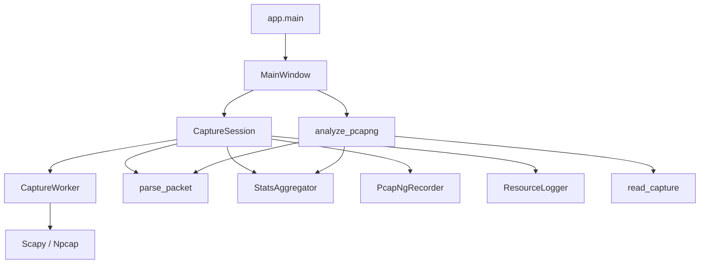
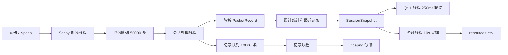

# 网络流量分析系统：架构与后续工作

更新日期：2026-11-16。代码基线：`15998cf`（W01～W07 修复后、长稳冻结版本）。

本文替换原《总体技术方案》，保留文件路径以兼容已有引用。第 1～8 节描述当前实现，第 9～11 节说明验证结果、缺口和后续工作。标为“待实现”的内容不能作为已完成功能写入报告。

相关资料：[课程要求](../计算机网络课程设计_要求_20261016.md)、[需求分析](01_需求分析.md)、[历史实现与测试记录](03_实现与测试记录.md)、[分工](04_分工与任务书.md)。历史测试记录反映 10 月 18 日的验证，不代表已经完成正式长稳。

## 1. 定位与架构结论

本项目是课程选题 2 的 Windows 本机网络流量分析桌面程序。用户选择一张网卡，采集可见报文，查看链路层、网络层和传输层关键字段，统计 IP 长度和协议分类，并保存、重新读取抓包文件。

系统采用单进程、多线程结构：Npcap 提供抓包能力，Scapy 负责报文解码和文件格式，项目代码负责字段提取、统计口径、会话调度和可视化。不存在服务端、数据库、云端上传或分布式采集。

当前主流程可演示，正常 Ethernet II 报文及小文件回读已有验证。架构方向继续沿用；2026-11-16 已补齐解析异常隔离、记录失败降级、磁盘余量保护和界面后台任务，连续一天以上的验收仍在进行。

### 1.1 支持范围

- 每个实时会话选择一个接口；GUI 开始新会话时创建新的 `CaptureSession`。
- 面向 Ethernet II、单层 VLAN、普通 IPv4/IPv6、TCP/UDP 字段；非首片不推测端口。
- ARP 等数据可计入“其它”，不提供完整应用层协议分析、TCP 流重组或载荷解密。
- 以 Npcap 暴露的链路数据为准，无线网卡通常以 Ethernet 形式交付报文；本软件不提供无线监听模式管理。
- 接口枚举包含回环、虚拟网卡等，但当前解析器和记录器没有保留链路类型，不代表这些接口均被正确支持。
- BPF 是抓包前过滤，不是对已抓报文的显示筛选；统计和保存均只针对过滤后的输入。
- SYN 泛洪、ICMP 异常检测属于可选扩展，当前未实现。

## 2. 技术路线与取舍

| 技术 | 当前版本/方式 | 职责与取舍 |
| --- | --- | --- |
| Windows Python | 本机 3.14.7；项目声明 `>=3.12` | 使用已有 Windows 环境；并非所有声明版本都经过验证 |
| Npcap | 既有驱动；历史记录为 1.10.4，11 月 16 日确认服务运行 | 提供系统抓包接口，目标电脑需安装兼容驱动 |
| Scapy | 2.8.0 | 抓包封装、协议解码、pcap/pcapng 读写；无需依赖 tshark |
| PySide6-Essentials | 6.12.0 | Qt Widgets 桌面窗口、表格模型和事件循环 |
| pyqtgraph | 0.14.0 | 长度折线图及两类柱状图 |
| psutil | 7.2.2 | 进程 CPU、RSS、写入量、系统内存及磁盘余量采样 |
| pytest | 9.1.1 | 核心逻辑、文件读写和 GUI 离屏测试 |
| PyInstaller | 6.22.3，one-dir | 生成包含运行依赖的 Windows 程序目录 |

采用文件保存原始报文，便于回读和答辩复核；目前不需要数据库。采用线程隔离等待和磁盘操作，但 Python 线程不等于 CPU 并行解析，不能以此宣称具备高速链路全量采集能力。

继续保留纯 Python 的解析、统计核心与 Qt 界面之间的边界。优先补齐故障处理，不为此次课程设计引入额外服务或重构成复杂框架。

## 3. 模块与依赖

代码位于 `src/packet_analyzer/`。下表列的是实际对象，不是计划中的模块。

| 文件 | 主要对象 | 职责 |
| --- | --- | --- |
| [app.py](../src/packet_analyzer/app.py) | `main()`、`_run_self_test()` | 启动 GUI；提供短时抓包自检入口 |
| [models.py](../src/packet_analyzer/models.py) | `RawPacket`、`PacketRecord` | 原始字节、时间与线上长度；供展示和统计使用的字段记录（含 `parse_error`、`unsupported`） |
| [capture.py](../src/packet_analyzer/capture.py) | `InterfaceInfo`、`discover_interfaces()`、`CaptureWorker` | 接口枚举、BPF 配置、异步抓包、抓包队列 |
| [parser.py](../src/packet_analyzer/parser.py) | `parse_packet()` | 从原始字节提取所需协议字段 |
| [statistics.py](../src/packet_analyzer/statistics.py) | `StatsAggregator`、`StatsSnapshot` | 聚合计数、最近速率及不可变统计快照 |
| [recording.py](../src/packet_analyzer/recording.py) | `PcapNgRecorder`、`read_capture()` | 分段写入、单文件导出和流式回读；`read_pcapng` 是兼容别名 |
| [resources.py](../src/packet_analyzer/resources.py) | `ResourceLogger` | 独立线程定期向 CSV 写入进程与会话指标 |
| [session.py](../src/packet_analyzer/session.py) | `CaptureSession`、`SessionSnapshot`、`analyze_pcapng()` | 协调抓包、处理、记录和资源日志；离线分析文件 |
| [ui/main_window.py](../src/packet_analyzer/ui/main_window.py) | `MainWindow`、`PacketTableModel`、`DetailTree`、`SummaryPanel`、`ChartsPanel` | 用户操作、表格、字段树、概览和图表 |

表格、详情和图表类目前集中在 `main_window.py`，并没有独立的 `packet_model.py`、`detail_view.py` 或 `charts.py`。核心模块不依赖 Qt；界面通过会话接口获得快照，避免直接修改统计器。



## 4. 线程、数据流与容量

### 4.1 实时抓包路径



1. `AsyncSniffer(store=False)` 调用抓包回调。Scapy 已提供报文对象，回调将其序列化为字节，保存时间戳和线上长度，形成 `RawPacket`。
2. 回调非阻塞入队；队列满时丢弃该条，增加应用采集队列丢弃计数。
3. 处理线程重新以 `Ether(raw)` 解码，调用 `parse_packet()`，得到 `PacketRecord`。
4. 处理线程在锁内更新聚合统计和最近记录，然后将原始报文送入记录队列。记录队列满时增加 `record_dropped`，统计已更新但该条不会落盘。
5. 记录线程写入 pcapng；GUI 每 250ms 获取统计及最近记录快照，更新表格、详情与图表。
6. 资源线程每 10 秒采样并写 CSV。GUI 的 CPU/RSS 显示由界面另外调用 psutil 获取，不由日志线程推送。

### 4.2 状态所有权与内存

| 状态 | 所有者/同步方式 | 容量和限制 |
| --- | --- | --- |
| 抓包队列 | `CaptureWorker` 的线程安全队列 | 50000 条原始报文 |
| 记录队列 | `CaptureSession` 的线程安全队列 | 10000 条原始报文 |
| 累计计数 | 处理线程更新；快照读取使用 `RLock` | 不保存全部历史报文对象 |
| 最近报文 | `deque(maxlen=10000)`，与统计共用锁 | 实时表格只能查看最近 10000 条 |
| 离线报文 | `analyze_pcapng()` 的局部缓存 | GUI 请求最近 50000 条；统计仍扫描整个文件 |
| 统计/会话快照 | 冻结 dataclass 和 tuple | 传递字段及计数，不传递全部原始字节 |
| pcapng 文件 | 单个记录线程写入 | 分段数量和总磁盘占用目前没有上限 |

队列限制的是条数，不是字节数；大报文和队列积压仍可能占用大量内存。正常流量下使用固定缓存有助于控制增长，但不能替代实测，也不能承诺 24 小时必然低于某个内存值。

统计快照和最近列表复制会占用锁；GUI 表格在缓存首条发生变化时重置模型。两个柱状图每次刷新会清除并重建图元，即使当前标签页不可见也会更新。因此仍需在长时间、满缓存情况下测量刷新成本。

## 5. 协议模型与统计口径

### 5.1 数据契约

- `RawPacket(timestamp, data, wire_length)`：保留原始报文、时间戳和捕获来源提供的线上长度；当前缺少链路类型。
- `PacketRecord`：序号、时间、帧长度、MAC、EtherType、VLAN ID、IP 字段、端口、TCP 标志、摘要及解析错误。字段缺失时通常用 `None` 表示。
- `StatsSnapshot`：报文总数、解析成功/错误数、IPv4/IPv6/其它数量、捕获字节数、长度频次、分桶和协议计数，以及速率。
- `SessionSnapshot`：统计快照、最近记录、运行标记、开始时间、运行时长、队列深度、应用丢弃计数、记录状态、分段列表和最近错误。

### 5.2 字段解释

| 字段 | 当前实现 | 需要注意的边界 |
| --- | --- | --- |
| MAC、EtherType | Ethernet 字段；VLAN 时取内层类型 | 外层 EtherType 未单独保留；802.3/LLC 帧已能安全记录（标记“不支持类型”，不再抛异常），但没有网络层字段 |
| VLAN | 遍历 `Dot1Q`，每次覆盖 VLAN ID | 多标签时只保留最后一层 ID，不是完整标签栈 |
| IP 地址、版本 | IPv4/IPv6 层字段 | 当前按 EtherType 选择对应解析分支 |
| TTL/Hop Limit | IPv4 TTL；IPv6 Hop Limit | GUI 对 IPv6 使用 Hop Limit 名称 |
| 协议号 | IPv4 `proto`；IPv6 有 TCP/UDP 时取最终协议 6/17，否则取基础头 Next Header | 有扩展头且非 TCP/UDP 时（如 HBH+ICMPv6）可能显示基础头值，属于已定义口径 |
| TCP/UDP 端口 | 只看最外层 IP 头直接承载的传输层 | 隧道报文不再混用外层 IP 与内层端口；非首片不取端口 |
| TCP 标志 | SYN、ACK、FIN、RST 位 | 不表示已完成 TCP 连接跟踪或状态机分析 |
| 分片 | IPv4 非首片、IPv6 非首片不提取端口 | 不做分片重组 |
| 线上长度 | `RawPacket.wire_length` 透传给解析器 | 截断帧的详情显示真实线上长度；回读文件时取记录中的 wirelen |

### 5.3 长度与分类

本项目已采用以下口径，原课程要求的区间写法存在歧义，最终报告需注明项目解释：

- IPv4 长度取 IP 首部的总长度；IPv6 通常取 `40 + Payload Length`，代码在该字段为 0 时退回序列化长度。
- 长度折线图和分桶只统计有正 IP 长度的记录；ARP 等非 IP 数据不进入长度统计。
- 三个分桶互斥：`<=46`、`47–1499`、`>=1500`。
- IPv4/IPv6/其它按解析结果的 `ip_version` 分类；解析失败可能归入“其它”，与纯 EtherType 分类并不完全等价。
- 累计字节统计的是捕获帧字节数，不是 IP 字节数，也不是完整线上占用。
- 速率是最近 5 个整秒桶内的报文数除以 5，不是链路带宽或吞吐量。

长度图补齐未出现长度的零计数，再绘制曲线；这避免把未观测区间直接连成斜线。默认查看 0～1600 字节，完整视图的绘制数组当前截到 65535，超长 IPv6 情形尚未完整处理。

### 5.4 计数一致性

正常无丢弃、正常停止并排空队列时，应满足：

```text
总记录数 = 解析成功数 + 解析错误数
总记录数 = IPv4 数 + IPv6 数 + 其它数
三段长度计数之和 = 有效 IP 长度计数之和
实时累计数量和分布 = 回读保存文件后的累计数量和分布
```

最后一条比较累计数量和分布，不比较以当前时间为基准的实时速率；它还有前提：当前统计先于记录，记录队列丢弃或写入失败时，文件数量可能小于实时统计。资源 CSV 的 `captured` 实际取处理后的统计总数，不是 Npcap 原始接收数。现有“丢包”指标只有应用队列丢弃，不包括驱动丢包，界面上的 0 不能解释为整条链路零丢包。

## 6. 文件、回放与部署

### 6.1 保存格式

GUI 默认在 `data/sessions/年月日_时分秒/` 下建立会话目录：

| 文件 | 内容 | 当前行为 |
| --- | --- | --- |
| `capture_时间_序号.pcapng` | 原始字节、时间戳、捕获长度和线上长度 | 记录器写死 Ethernet linktype=1 |
| `session.json` | 开始/结束时间、接口、BPF、版本、分段名 | 正常停止流程写入；直接写文件，不是原子替换 |
| `resources.csv` | 资源采样和应用计数 | 每 10 秒写入并 flush，停止时补一条 |

分段阈值为 `256 * 1024 * 1024` 字节，即 256 MiB；按“原始字节数 + 每包估算 64 字节开销”累计，不保证每个文件精确等于阈值。分段控制单文件大小，不控制总磁盘用量，也没有自动淘汰旧文件。

导出单文件时，一个分段直接复制；多个分段流式读取后重新写入临时 pcapng，再替换目标文件。不要把这描述为所有写入均具备原子性。长稳脚本结束时会额外导出完整文件，需要考虑近一份原始记录大小的额外磁盘空间。

### 6.2 离线回读

`read_capture()` 选择 Scapy 文件读取器，逐条产生 `RawPacket`；`analyze_pcapng()` 复用实时解析器和统计器。这个共享路径减少实时与离线统计规则不一致的风险。

目前 GUI 在主线程同步调用分析函数及导出函数，没有进度或取消。流式读取只避免一次性载入全部原始报文，并不等于后台读取。打开文件会先停止实时抓包；成功后进入离线展示，运行时长栏显示文件首尾报文时间差，不是原会话的连续运行证明。

### 6.3 部署与入口

- `run.bat` / `run_console.bat`：使用本地 `.venv`，要求先安装项目及依赖。
- `build.bat`：PyInstaller one-dir 打包；`run_exe.bat` 启动打包程序。
- 发布时需携带整个 `dist/NetworkTrafficAnalyzer/`，不能只复制其中的 `.exe`。
- Npcap 驱动不是 Python 依赖，另一台电脑需要单独准备。
- 项目当前脚本部分使用固定 `E:\CN_work`、`WLAN` 或历史测试 IP；还没有完整的新电脑初始化流程。
- `.venv`、`data`、`dist`、`build` 等被 Git 忽略；从仓库克隆不会自动得到可执行程序和测试抓包证据。

## 7. 会话生命周期与故障边界

当前生命周期由多个布尔标记、线程引用和 `None` 队列哨兵实现，没有统一状态机。

| 阶段 | 当前实现 | 限制 |
| --- | --- | --- |
| 开始 | 建立记录器和日志线程、处理线程，然后启动异步抓包 | 抓包启动仍用 150ms 后检查，未改为可靠就绪事件 |
| 运行 | 处理报文、统计、入记录队列，GUI 轮询快照 | 处理线程异常会置 `running=False` 并显示错误；记录线程失败或磁盘不足会停止记录、继续统计 |
| 停止 | 先停抓包，再用带 5s 超时的哨兵入队、join 15s、关闭记录器、写元数据 | 线程未在时限内停止时保留文件不关闭，并记录错误 |
| 退出 | 窗口关闭时同步调用停止 | 故障路径最坏约 35s，仍会短暂阻塞界面 |

2026-11-16 复现并修复了两条关键故障路径：

1. 合法 `Dot3/LLC/STP` 帧经 `Ether(raw)` 得到 `Dot3` 对象，访问不存在的 `type` 抛出异常；处理线程退出而会话仍报告运行。现在解析器把 802.3/LLC 记为“不支持类型”，处理循环另有兜底捕获，线程不再退出（测试 `test_8023_stp_frame_is_recorded_as_unsupported`）。
2. 记录器抛错后记录线程退出但 `_recording=True`；记录队列满时关闭逻辑阻塞在无超时哨兵入队。现在记录失败会置 `_record_failed`、停止记录并关闭文件，哨兵与 join 全部带超时（测试 `test_stop_is_bounded_when_recorder_failed_and_queue_full`）。

磁盘余量低于 2 GiB 时记录器抛 `LowDiskSpaceError`，会话停止记录、继续统计并在状态栏提示；导出前也检查所需空间（测试 `test_recorder_refuses_to_write_when_free_space_is_low`、`test_export_checks_available_space`）。

## 8. 资源与运行证据

资源日志列为：

```text
timestamp,uptime_seconds,cpu_percent,rss_mb,disk_write_mb,
system_memory_percent,disk_free_mb,captured,parsed,parse_errors,
queue_dropped,record_dropped
```

- CPU 使用 psutil 进程口径，通常以一个逻辑核满载为 100%，可能超过 100%；报告要注明，不能直接与任务管理器总机器占用混用。
- RSS 是进程驻留内存；`disk_write_mb` 是进程累计写入字节增量，不等同于 pcapng 文件大小。
- 剩余磁盘只被记录，未触发保护；CSV 写入异常也缺少统一的会话故障反馈。
- 会话持续时间使用单调时钟，停止后冻结；开始时间在快照和 JSON 中，GUI 尚未明确展示。
- 时长计数本身不能证明中间始终健康采集，也不能代替休眠、断网和日志缺口检查。

`tools/soak_test.py` 仅运行后台会话，没有 GUI。它具备定时运行、保存和回读汇总，但还没有把提前中断、工作线程退出、时长不足和统计不一致作为严格验收失败条件。正式验证应覆盖 GUI 持续刷新，并保留软件版本、开始/结束时间、连续日志、错误/丢弃计数、抓包样本与截图。

## 9. 已验证能力与完成度

以下为 2026-11-16 对本工作区的核查结果，不代表工作区外不存在其它材料。

| 项目 | 证据 | 结论 |
| --- | --- | --- |
| 自动化测试 | 2026-11-16 重新执行 `python -m pytest`，35 项通过 | 新增 802.3/STP、满队列停止、磁盘不足、隧道端口、多分段导出等故障路径测试 |
| 普通协议、字段、分桶 | IPv4/TCP、IPv4/UDP、IPv6/TCP、ARP、单 VLAN、IPv4 非首片及分桶边界测试 | 主路径可用，不能推出所有协议边界正确 |
| 历史抓包回读 | 五份原始文件分别 154、121、197、229、53 条；分类核对一致 | 小文件回读已验证，五份文件 IPv6 均为 0 |
| GUI | 现有离屏渲染测试通过，已有历史截图 | 未证明长时间交互和大文件响应 |
| 发布产物 | 本地存在历史 one-dir 程序及自检记录 | 尚缺独立目标电脑验收记录 |
| 正式长稳 | 资源日志最长 22 秒；专用长稳汇总 7.2 秒 | 没有连续一天的本地验收证据 |
| 文档与分工 | 已有需求、方案、测试记录和 A/B/C/D 分工 | 最终报告、Visio 图、PPT、完整 DOC/SRC/BIN 提交包未在工作区找到 |

因此应描述为“基础功能覆盖较高、稳定性与验收证据尚不完整”。35 项通过不是 35 项课程要求均已验收，也不能把可选异常检测作为基础完成度的阻塞项。

## 10. 后续工作清单

优先级：P0 为正式长稳前必须处理，P1 为交付前必须完成或明确支持边界，P2 为有余力再做。负责人沿用 A/B/C/D；此表分配的是后续责任，不证明既往个人贡献。

| 编号 | 优先级 | 工作 | 主责/配合 | 验收标准 |
| --- | --- | --- | --- | --- |
| W01 | P0 | 解析异常隔离和会话健康状态 | A；D 复现 | 先加入 802.3/STP、空包及截断回归；不支持输入安全记录/跳过；后续正常包仍处理；后台失败状态不再伪装正常 |
| W02 | P0 | 停止、写入失败与满队列处理 | A、C；D 回归 | 先复现磁盘写入失败加满队列；停止在明确时限内返回，无残留工作线程；不会在线程仍写入时关闭文件 |
| W03 | P0 | 磁盘容量保护与记录降级 | C；A 集成、B 提示 | 沿用原方案约 2 GB 余量目标，建议明确采用 2 GiB 阈值；不足时停止记录、继续统计并显示状态；不自动删除用户数据；导出也检查所需空间 |
| W04 | P1 | 明确链路类型、封装层和长度元数据 | A；B、D 配合 | 回环等不支持接口明确拒绝/提示或正确支持；不再混合外层 IP 与内层端口；统一 IPv6 Next Header 语义；保留真实 wire length |
| W05 | P1 | 后台回读、导出及表格滚动体验 | B；C 配合 | 较大文件操作时窗口可响应，提供进度/取消；满缓存刷新不持续丢失用户选择；不因无变化快照反复重建所有图表 |
| W06 | P1 | 统计、保存与丢弃证据一致性 | C；D 验证 | 明确接收、处理、记录、丢弃含义；测试多分段导出和异常中断；无丢弃时保存/回读一致；未取得驱动指标时注明未知 |
| W07 | P1 | 补齐协议与故障测试矩阵 | D；A/B/C 各修本模块 | 覆盖 ARP、ICMP、TCP 标志、UDP、IPv6、VLAN、分片和不支持类型；记录流量来源、预期、实际和证据；IPv6 实机证据不足时如实注明 |
| W08 | P1 | 带 GUI 的连续一天以上验证 | D；全组配合 | P0 修复后先短时预跑，再完成至少 24 小时；记录版本、开始/结束时间和资源曲线；线程健康、日志连续、界面可交互；时长不足/中断不能标成功 |
| W09 | P1 | 独立部署与发布说明 | A；D 验证 | 新电脑或独立环境安装 Npcap 后可启动、选网卡、抓包、停止、保存、回读；提交整个 one-dir 目录和可复现构建说明 |
| W10 | P1 | 报告、图、答辩与最终提交包 | A 统稿；全组分模块 | 报告与代码能力一致；包含 Visio 图、测试及资源分析、使用说明、工作照片和成员确认；按课程要求组织 DOC/SRC/BIN 并打包 RAR |
| W11 | P2 | SYN 泛洪/ICMP 异常提示 | C；D 验证 | 基础验收完成后再加入；说明窗口、阈值、误报和漏报，不以提示替代准确检测结论 |

### 10.0 实施状态（2026-11-16）

| 编号 | 状态 | 证据 |
| --- | --- | --- |
| W01 | 完成 | 802.3/LLC 记为“不支持类型”，处理循环兜底；`test_8023_stp_frame_is_recorded_as_unsupported` |
| W02 | 完成 | 记录失败降级，哨兵与 join 全部带超时；`test_stop_is_bounded_when_recorder_failed_and_queue_full` |
| W03 | 完成 | 2 GiB 余量保护、导出前空间检查；`test_recorder_refuses_to_write_when_free_space_is_low`、`test_export_checks_available_space` |
| W04 | 完成（限 Ethernet II） | 线上长度透传、隧道端口隔离、IPv6 协议口径统一 |
| W05 | 完成 | 表格滑动窗口不重置、按序号恢复选中行、图表只重绘可见页、打开/导出转后台且可取消 |
| W06 | 完成 | 多分段导出回读数量一致；界面注明丢弃仅统计应用队列 |
| W07 | 完成（基础矩阵） | 35 项测试覆盖 ARP/ICMP/ICMPv6/TCP 标志/UDP/IPv6/VLAN/分片/802.3/截断 |
| W08 | 完成 | 2026-11-17 21:33 至 11-18 22:04 在阿里云 Windows Server 2022 云主机完成 24.52 小时 GUI 长稳：418,745 包、0 解析错误、0 丢弃、RSS 峰值 251.2 MB，证据 `data/sessions/20261117_213303` |
| W09 | 待做 | 打包自检通过（29 包、0 解析错误），待第二台机器或云主机走完整用户路径 |
| W10 | 进行中 | 报告、draw.io 图、PPT、DOC/SRC/BIN 待完成 |

### 10.1 执行顺序与验证方法

1. **先处理 W01～W03。** 每个错误先写最小复现测试，再局部修复；原 20 项和新增故障测试均需通过。
2. **补 W04～W07。** 对照协议预期验证字段，核对保存/回读计数；以较大文件实测 GUI 响应，不仅检查能否生成截图。
3. **冻结验收版本并执行 W08。** 正式长稳记录具体 commit；测试中修改运行代码后，应重新确认版本和证据有效性，必要时重跑。
4. **并行准备 W09～W10。** 文档框架可提前写，最终测试结论等待实测；发布程序从最终验收源码重新构建。W11 不阻塞基础交付。

### 10.2 时间建议

以 2026-11-16 为起点，原要求 11 月 26 日提交、11 月 27 日暂定答辩：

| 时间 | 建议目标 |
| --- | --- |
| 11 月 16～18 日 | P0 修复与故障回归；同步整理字段、统计和界面边界 |
| 11 月 19～21 日 | 完成主要协议验证和带 GUI 的正式长稳，预留修复后重跑时间 |
| 11 月 22～24 日 | 分析长稳数据，独立部署验证，完善报告、Visio 图和 PPT |
| 11 月 25 日 | 最终包核查及全组演示 |
| 11 月 26 日 | 按学校要求提交 |

任务书原截止为 10 月 23 日，本地没有足以确认已提交的记录；实际提交状态需以教学平台为准，不能根据文档存在就认定完成。

## 11. 文档维护与交付边界

- 模块、队列、统计口径和线程行为变化时同步更新本文；测试通过情况必须附日期和代码版本。
- 已知缺陷修复后，应将对应工作项更新为“完成 + 验证证据”，不能只删除问题描述。
- 四名成员按各自模块提供设计取舍、代码解释和测试证据，工作量比例最终按实际贡献共同确认。
- 本文 Mermaid 图用于架构阅读；课程报告要求的专业绘图材料仍需另行完成，不能把本文存在视为 Visio 交付已经完成。
- 本次文档替换没有修复源码、执行正式长稳或生成最终提交包。

## 12. 若项目由单人完成的工作规划

本节以“由一人接手当前代码，完成剩余开发、验证和材料”为假设，不是从零重做。课程原要求为 2～5 人成组；以下是技术执行规划，正式单人参课是否允许需以教师要求为准。若仍以小组提交，报告应如实记录各人的实际贡献。

### 12.1 范围与工作方式

单人依次承担开发、测试、发布和文档职责，按依赖顺序推进，不同时改动多个子系统。保留当前 Windows、Scapy、Qt 和文件存储方案。

- 必须保留：三层关键字段、三类统计图、原始数据保存与回读、运行信息、资源记录和连续一天以上验证。
- 首先修复：W01～W03 的解析异常、停止阻塞和磁盘风险，这些决定长稳结果是否可信。
- 限定支持范围：以常用 Ethernet II 网卡为主；暂不支持的链路类型明确提示，不追求完整协议覆盖，但不能因此遗漏课程要求的 IPv4/IPv6 和 TCP/UDP 基本字段。
- 交付前补齐：W04～W10 的必要正确性、交互、测试、部署和材料。W05 优先解决阻塞与选择丢失，视觉美化延后。
- 可选项延期：W11 异常检测、多网卡同时采集、流重组和额外界面美化，不纳入本轮必交范围。
- 每完成一个工作包，保留对应测试输出和简短设计说明，避免最后集中补写所有报告材料。

### 12.2 工作包、耗时与完成条件

以下为剩余工作的粗估净投入时间，不包含正式长稳等待和不可预见的环境问题；不是完成承诺。

| 顺序 | 工作包 | 关联事项 | 净投入估算 | 完成条件 |
| --- | --- | --- | --- | --- |
| 1 | 建立基线与问题清单 | W01～W10 | 2～3 小时 | 运行现有测试，记录版本、已复现问题及提交物清单 |
| 2 | 修复可靠性故障 | W01～W03 | 8～12 小时 | 先写复现测试；解析异常、记录失败、队列满、停止和低磁盘空间测试通过 |
| 3 | 修正协议与保存语义 | W04、W06 | 5～8 小时 | 字段不混层，线上长度正确，支持边界明确，多分段回读与累计统计一致 |
| 4 | 完善交互与协议验证 | W05、W07 | 6～10 小时 | 大文件读写时窗口可响应；满缓存可正常查看详情；协议矩阵有预期、结果和证据 |
| 5 | 预跑、冻结版本与正式长稳 | W08 | 3～5 小时，另加至少 24 小时连续运行 | 先短时预跑；正式运行版本明确，后台健康、日志连续，结束后能核对统计与资源趋势 |
| 6 | 部署和发布复核 | W09 | 3～5 小时 | 打包程序在另一台电脑或独立测试环境完成启动、抓包、停止、保存与回读 |
| 7 | 报告、图、PPT 和提交包 | W10 | 10～15 小时 | 按课程要求完成材料和 DOC/SRC/BIN；报告数据可追溯，实际能力与文字一致 |

净投入合计约 **37～58 小时**，另需至少一次连续 24 小时运行，以及一次修复后重跑的日历余量。长稳期间可以写文档和制作图表，但应记录同时运行的工作负载，避免把测试电脑空闲时与重负载时的数据直接混为同一性能结论。

### 12.3 按当前截止日期安排

按 11 月 16 日开始、11 月 26 日提交安排；这要求平均每天能投入约 4～6 小时，具体以故障修复进展调整。

| 日期 | 单人主要任务 | 当日检查点 |
| --- | --- | --- |
| 11 月 16 日 | 建立基线，复现并开始修复解析和停机故障 | 基线可重现，失败测试明确 |
| 11 月 17～18 日 | 完成可靠性修复、磁盘保护和必要协议语义修正 | W01～W03 通过；W04/W06 的关键错误关闭 |
| 11 月 19 日 | 完成交互修复、协议矩阵和至少 1 小时预跑；记录验收版本 | 无未处理的阻塞性故障，具备正式长稳条件 |
| 11 月 20～21 日 | 启动并完成超过 24 小时的 GUI 长稳；期间撰写报告主体和架构图 | 不修改运行版本；保存开始/结束时间、资源日志和交互证据 |
| 11 月 22～23 日 | 分析结果；必要时修复并重新连续运行至少 24 小时；通过后做部署验证 | 为一次失败重跑保留完整时间；未通过不得写成成功 |
| 11 月 24 日 | 完成报告、使用说明、Visio 图和 PPT | 所有结果对应已验证版本，已知限制写清 |
| 11 月 25 日 | 最终构建、演示彩排、核查并生成 RAR | 从提交包能复现部署和演示，文件命名与目录正确 |
| 11 月 26 日 | 提交并保留提交记录 | 最终包、版本和提交记录一致 |

若 11 月 19 日仍未解决阻塞性故障，优先删除可选扩展计划，把时间用于基础要求和长稳。不能通过缩短连续运行时长、拼接多次短时日志或只跑后台脚本来填补 GUI 长稳证据；若仍无法按期完成，应如实说明未完成项。

### 12.4 单人自检与交付判定

缺少另一位成员交叉检查时，采用固定清单进行第二轮复核：

1. **实现后按失败场景复核。** 除正常抓包外，检查不支持帧、非法过滤器、记录失败、队列满、停止和窗口关闭；错误修复先有失败测试，再确认原有测试不回退。
2. **使用独立预期核对协议。** 构造已知字段和长度的报文，将预期与解析结果比较。保存和回读共用同一解析器，只能证明两条路径一致，不能单独证明字段一定正确。
3. **逐项记录证据。** 以“需求—实现位置—验证方法—证据—状态”维护清单；截图、日志、测试结果标明日期和软件版本。
4. **按用户路径复核发布包。** 从启动到选择网卡、抓包、查看详情、停止、保存和回读完整操作一次，确认交付目录不依赖开发机的固定路径。
5. **核对最终验收条件。** 基本功能可演示，故障回归通过，正式长稳和资源分析完成，部署有记录，报告/图/PPT/提交包齐全，所有未支持项明确说明。

单人完成时，最重要的交付顺序是：**可靠性 → 协议与数据正确性 → 正式长稳 → 发布与课程材料**。时间不足时压缩可选功能和美化，保留硬性要求、测试证据和必要说明。
