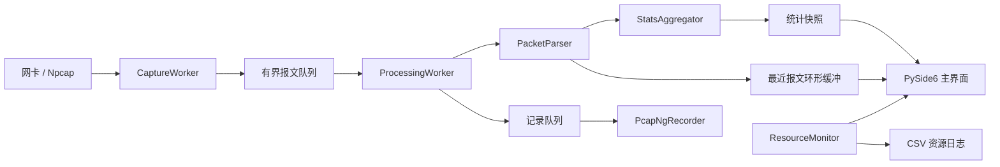

# 网络流量分析系统：总体技术方案

## 1. 方案目标

本方案以“能抓、能解析、能统计、能保存、能连续运行”为主线，优先保证课程要求的 P0 功能，再增加异常检测和过滤等扩展。技术选择尽量复用本机已有条件：Windows 11、Python 3.14、Npcap 1.10.4 和项目内虚拟环境。

## 2. 本机环境核查

核查日期：2026-10-18。

| 项目 | 实测结果 |
| --- | --- |
| 操作系统 | Windows 11 Home China，10.0.26200，64 位 |
| CPU | AMD Ryzen 9 7940HX，16 核 / 32 线程 |
| 内存 | 16 GB，核查时约 1.8 GB 可用 |
| 磁盘 | E: 约 33 GB 可用，适合放项目和测试数据 |
| 主用网卡 | WLAN，Realtek 8852BE，核查时 IP 为 `10.195.116.151` |
| 抓包驱动 | Npcap 1.10.4，服务正在运行，`AdminOnly=0`，兼容 WinPcap API |
| Windows Python | Python 3.14.7，64 位 |
| 项目虚拟环境 | `E:\CN_work\.venv`，约 348 MB |
| 抓包验证 | Scapy 通过 Npcap 在 WLAN 抓到 366 个真实报文，包含 ARP、ICMP、UDP |
| Wireshark/tshark | 未安装；本方案不依赖它们 |

已安装的核心依赖：

| 依赖 | 版本 | 用途 |
| --- | --- | --- |
| PySide6-Essentials | 6.12.0 | 桌面 GUI |
| pyqtgraph | 0.14.0 | 实时折线图和柱状图 |
| Scapy | 2.8.0 | 抓包、报文解析和 pcapng 读写 |
| psutil | 7.2.2 | CPU、内存、磁盘和进程资源监控 |
| pytest | 9.1.1 | 单元测试和集成测试 |
| PyInstaller | 6.22.3 | Windows 可执行程序打包 |

结论：不需要安装 Wireshark 或 tshark；使用 Windows Python 虚拟环境直接调用 Npcap，技术路线已在真实网卡上验证。WSL 中的 Python 不用于 GUI 和 Windows 抓包。

## 3. 总体架构



设计原则：

1. GUI 主线程只负责绘制和用户交互，不做抓包和解析；
2. 抓包回调只复制必要数据，不做耗时解析；
3. 所有跨线程队列有容量上限，避免高流量下内存无限增长；
4. 统计使用聚合计数，不依赖保存全部报文；
5. 报文详情只保留最近一段记录，长时间运行内存可控；
6. 原始数据由独立写入线程落盘，磁盘慢时不阻塞界面。

## 4. 技术选型

| 层次 | 选择 | 理由 |
| --- | --- | --- |
| 语言 | Python 3.14 | 本机已有，开发效率高，Scapy/Qt 生态完整 |
| GUI | PySide6-Essentials | Qt Widgets 成熟，表格和分栏能力强，许可清晰 |
| 图表 | pyqtgraph | 适合实时数据，依赖轻，性能优于频繁重绘的静态图表 |
| 抓包 | Scapy + Npcap | 已实测可用，无需 tshark；支持接口枚举和 pcapng |
| 持久化 | pcapng + JSON 元数据 | pcapng 保留原始字节和时间戳，便于回读和复核 |
| 资源监控 | psutil | 跨平台、接口简单，可获取进程 CPU/RSS/IO |
| 测试 | pytest | 适合纯逻辑单元测试和集成测试 |
| 打包 | PyInstaller one-dir | 比 one-file 启动稳定，便于排查 Qt 插件问题 |

## 5. 模块划分

建议目录结构：

```text
CN_work/
├── src/packet_analyzer/
│   ├── __init__.py
│   ├── app.py                  # 程序入口
│   ├── models.py               # PacketRecord、统计快照等数据模型
│   ├── parser.py               # 报文解析
│   ├── statistics.py           # 统计聚合
│   ├── capture.py              # 网卡枚举、抓包线程
│   ├── recording.py            # pcapng 写入、分段和回读
│   ├── resources.py            # 资源采样
│   ├── session.py              # 会话编排
│   └── ui/
│       ├── main_window.py      # 主窗口
│       ├── packet_model.py     # 表格模型
│       ├── detail_view.py      # 字段树
│       └── charts.py           # 图表组件
├── tests/
│   ├── test_parser.py
│   ├── test_statistics.py
│   ├── test_recording.py
│   └── test_session.py
├── tools/
│   ├── check_environment.py
│   └── capture_smoke_test.py
├── docs/
├── data/                       # 本地测试数据，不进入源码包
├── dist/                       # 打包产物
└── requirements.txt
```

## 6. 抓包设计

### 6.1 网卡枚举

- 使用 `scapy.all.conf.ifaces` 获取 Npcap 可见接口；
- 展示友好名称、描述、MAC 和 IPv4/IPv6 地址；
- 优先选择状态为 Up 且带有效 IP 的物理网卡；
- 过滤明显不可用的 WAN Miniport，但保留高级用户手动选择能力。

### 6.2 抓包线程

- 每次会话创建一个 `CaptureWorker`；
- 使用 `AsyncSniffer(iface=network_name, store=False, prn=callback)`；
- 回调中只提取时间戳、原始字节和线上长度，然后放入有界队列；
- 支持可选 BPF 过滤表达式；
- 停止时调用 `sniffer.stop()`，等待线程退出，避免残留句柄；
- 捕获 Npcap 统计中的接收/丢弃数量，无法获取时至少统计应用层队列丢弃数。

### 6.3 队列与背压

- 抓包到处理队列默认容量 50,000 条；
- 处理到记录队列默认容量 10,000 条；
- 队列满时不阻塞抓包回调，直接丢弃并累加 `queue_dropped`；
- 状态栏和资源日志同时显示应用丢弃和驱动丢弃，避免把丢包误认为解析错误。

## 7. 报文解析设计

### 7.1 解析入口

`PacketParser.parse(raw: bytes, timestamp: float, index: int) -> PacketRecord`：

1. 用 Scapy 解析原始字节；
2. 只访问需要的层，避免完整深度解析；
3. 任何异常转为“解析失败记录”，保留时间、长度和错误信息；
4. 返回不可变的 `PacketRecord`，供统计、表格和详情共同使用。

### 7.2 关键字段

| 字段 | 来源 |
| --- | --- |
| 源/目的 MAC | `Ether.src`、`Ether.dst` |
| EtherType | `Ether.type`；VLAN 时读取 `Dot1Q.type` |
| IP 版本 | `IPv4.version` 或 `IPv6.version` |
| 源/目的 IP | `IPv4.src/dst` 或 `IPv6.src/dst` |
| TTL | `IPv4.ttl`；IPv6 使用 `IPv6.hlim` 并标注为 Hop Limit |
| 协议号 | `IPv4.proto` 或 IPv6 最终 Next Header |
| TCP/UDP 端口 | `TCP.sport/dport`、`UDP.sport/dport` |
| TCP 标志 | `TCP.flags` 中的 S/A/F/R |
| IP 长度 | `IPv4.len` 或 `40 + IPv6.plen` |

### 7.3 IPv6 与分片

- 支持基础 IPv6 头和无扩展头的 TCP/UDP；
- 对常见扩展头（Hop-by-Hop、Routing、Fragment、Destination Options）逐步支持；
- IPv6 分片无法取得传输层端口时显示 `N/A`；
- IPv4 非首片不猜测端口；
- VLAN 双层标签作为扩展场景测试，至少正确处理单层 802.1Q。

## 8. 统计设计

### 8.1 聚合结构

```text
StatsAggregator
├── total_packets
├── parsed_packets
├── parse_errors
├── ether_type_counts
├── protocol_counts
├── length_counts: Counter[int]
├── length_buckets: {<=46, 47-1499, >=1500}
├── per_second_counts
└── dropped_counters
```

统计只保存聚合结果，因此运行 24 小时后内存不会随报文数量线性增长。

### 8.2 长度折线图

- X 轴为 IP 分组长度，Y 轴为出现次数；
- 默认视图聚焦 `0-1600` 字节，并支持缩放到完整 `0-65535`；
- 使用 pyqtgraph 的 `PlotDataItem`，每次刷新只替换数组，不重建曲线对象；
- 非 IP 报文不进入该图。

### 8.3 分段柱状图和协议柱状图

- 分段：`<=46`、`47-1499`、`>=1500`；
- 协议：IPv4、IPv6、其它；
- 图表使用同一份统计快照，保证与表格和资源日志一致；
- 每秒最多刷新 4 次，避免高流量时频繁重绘。

## 9. 持久化设计

### 9.1 pcapng 写入

- 使用 Scapy `PcapNgWriter` 写入原始报文；
- 每个会话保留开始时间、网卡、过滤器和软件版本等元数据；
- 默认按 256 MB 分段，文件名包含会话时间和序号；
- 停止抓包后提供“导出当前会话为单个 pcapng”；
- 写入线程异常时停止写入并在界面告警，统计线程继续工作。

### 9.2 回读

- 使用 `PcapNgReader` 流式读取，不一次性加载全部报文；
- 复用同一 `PacketParser` 和 `StatsAggregator`，避免回读与实时统计口径不一致；
- 回读时显示进度，支持取消；
- 完成后恢复表格、详情和三类图表。

### 9.3 磁盘保护

- 启动时检查目标目录可用空间；
- 低于 2 GB 时停止原始数据写入，保留聚合统计；
- 界面持续提示“仅统计，未记录原始报文”；
- 24 小时运行建议使用分段写入，并定期清理测试数据。

## 10. GUI 设计

### 10.1 主窗口布局

```text
┌─────────────────────────────────────────────────────────────┐
│ 网卡选择  过滤表达式  开始/停止  打开  保存  运行时长       │
├───────────────────────────────────────┬─────────────────────┤
│ 报文列表                              │ 会话概览            │
│ 序号 时间 源MAC 目的MAC 类型 ...      │ 总数/解析/错误/丢包 │
│                                       │ CPU/内存/磁盘       │
├───────────────────────────────────────┤                     │
│ 字段详情树                            │ 图例与操作提示      │
├───────────────────────────────────────┴─────────────────────┤
│ 长度折线图 / 长度分段柱状图 / 协议分类柱状图                │
├─────────────────────────────────────────────────────────────┤
│ 状态栏：抓包状态、已运行时间、队列长度、丢包数              │
└─────────────────────────────────────────────────────────────┘
```

### 10.2 表格性能

- 使用 `QAbstractTableModel`，不使用逐行创建控件的 `QTableWidget`；
- 环形缓冲默认保留最近 10,000 条报文；
- 新报文按批追加，界面每 250 ms 拉取一次增量；
- 排序和筛选在快照层执行，不阻塞抓包线程。

### 10.3 字段详情

- 顶部节点：Frame；
- 以太网节点：源/目的 MAC、EtherType、VLAN（如有）；
- IPv4/IPv6 节点：版本、源/目的 IP、TTL/Hop Limit、协议号、总长度；
- TCP/UDP 节点：源/目的端口；
- TCP 节点额外显示 SYN/ACK/FIN/RST；
- 不可用字段统一显示 `N/A`，不隐藏节点，便于答辩解释。

## 11. 24 小时运行设计

### 11.1 稳定性

- 抓包、处理、写入和 GUI 分离，单一线程异常不直接终止整个进程；
- 所有线程使用明确的停止事件和超时 join；
- 未处理异常写日志，并在界面给出会话错误状态；
- 最近报文使用固定容量 `deque`，统计只保留计数器。

### 11.2 资源日志

每 10 秒写入一行 CSV：

```text
timestamp,uptime_seconds,cpu_percent,rss_mb,disk_write_mb,
captured,parsed,parse_errors,queue_dropped,driver_dropped
```

同时记录系统可用内存和磁盘剩余空间。报告阶段可直接使用 CSV 生成资源曲线。

### 11.3 界面运行信息

- 会话开始时间；
- 已运行时长 `HH:MM:SS`，超过 24 小时继续累加；
- 当前抓包状态；
- 已抓包数、已解析数、解析错误数、队列丢弃数；
- 当前进程 CPU 和内存；
- 当前记录文件或“仅统计”状态。

## 12. 测试方案

### 12.1 单元测试

- 解析器：ARP、IPv4/TCP、IPv4/UDP、IPv6/TCP、IPv6/UDP、VLAN、分片、截断报文；
- TCP 标志：分别构造 SYN、ACK、FIN、RST 组合；
- 字段：MAC、IP、TTL/Hop Limit、协议号、端口；
- 长度统计：46、47、1499、1500 边界；
- 协议分类：IPv4、IPv6、ARP、未知 EtherType；
- pcapng：写入、流式读取、统计一致性。

### 12.2 集成测试

- 使用真实网卡抓取 ping 流量，验证 ARP/ICMP 和 IPv4 字段；
- 打开网页或执行 DNS 查询，验证 TCP/UDP 和端口；
- 保存会话后重新加载，对比总数和三类统计；
- GUI 冒烟测试：启动、选择网卡、开始/停止、选择报文、切换图表。

### 12.3 性能与长稳测试

- 回放 10,000 条构造报文，记录解析耗时和峰值内存；
- 先进行 1 小时稳定性测试，再进行 24 小时连续运行；
- 每 10 秒采样一次资源，检查内存是否持续增长；
- 记录界面响应、队列丢弃和驱动丢弃；
- 24 小时结束后保存 pcapng、资源 CSV 和界面截图。

## 13. 打包与部署

- 使用 PyInstaller one-dir 方式打包，生成 `dist/NetworkTrafficAnalyzer/`；
- 入口为 `src/packet_analyzer/app.py`；
- 包含 PySide6 Qt 插件、pyqtgraph、Scapy 数据和程序图标；
- 目标电脑需安装 Npcap；提供安装说明和检测提示；
- 在无开发环境的 Windows 电脑上做一次启动和抓包验证；
- `BIN` 目录放打包程序、Npcap 安装包或下载链接、使用说明。

## 14. 实施顺序

1. 数据模型、解析器、统计器和单元测试；
2. 抓包线程、会话编排和真实抓包集成测试；
3. pcapng 写入、回读和一致性测试；
4. PySide6 主界面、表格、详情和图表；
5. 资源日志、24 小时稳定性测试和优化；
6. 打包、GUI 冒烟测试和答辩演示数据；
7. 报告、使用手册和 PPT（后续阶段）。

## 15. 代码规范

- 使用 Python 类型标注和 `dataclass(slots=True)`；
- 核心逻辑不导入 Qt，保证可以在无 GUI 环境下测试；
- 抓包和 GUI 之间只通过数据模型和队列通信；
- 所有文件写入使用临时文件加原子替换，避免损坏原文件；
- 异常必须记录上下文，不静默吞掉；
- 提交前运行 `pytest`，并通过真实网卡抓包冒烟测试。
