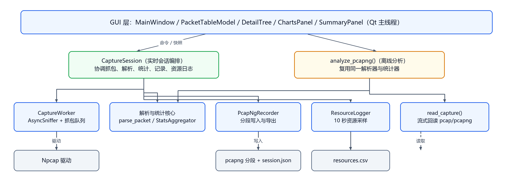
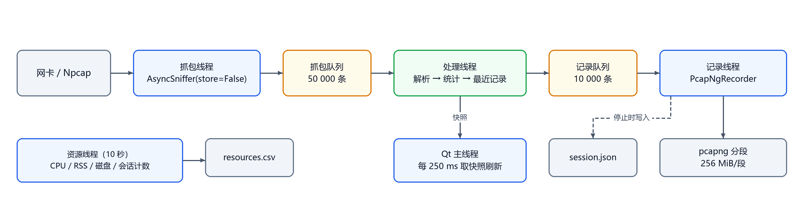
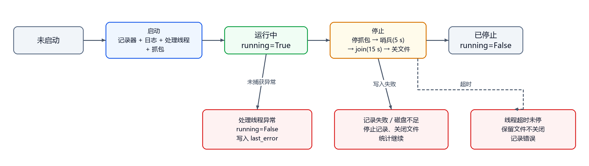
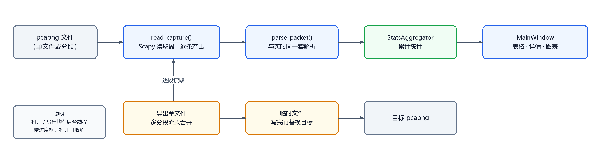
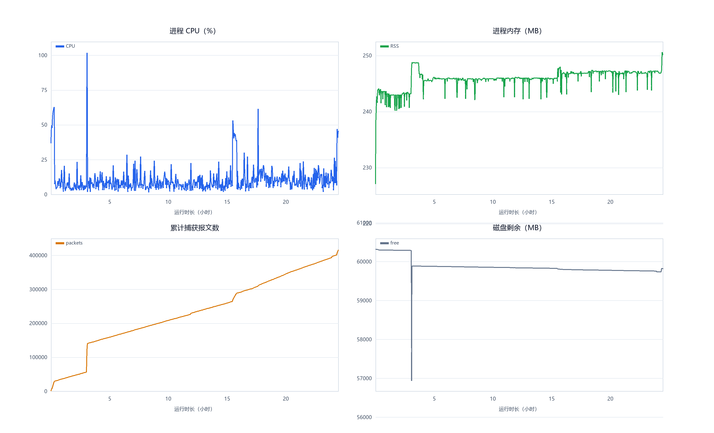

# 摘要

本报告面向《计算机网络》课程设计选题 2“网络流量分析系统”，设计并实现了一个 Windows 本机流量分析程序 FlowLens 流镜。系统以 Npcap 为抓包驱动、Scapy 为协议解码与抓包文件读写库、PySide6 为界面框架、pyqtgraph 为图表库，采用单进程多线程结构，将抓包、解析统计、原始记录、资源采样与界面刷新分离。程序支持网卡枚举、Ethernet II 与 IPv4/IPv6/TCP/UDP 关键字段展示、IP 长度频次折线图、长度分段柱状图、IPv4/IPv6/其它数据柱状图、pcapng 分段记录、单文件导出与回读，以及运行时长和资源日志。报告说明字段与统计口径、线程与数据契约、故障隔离与磁盘保护、测试矩阵与打包自检结果；并用云主机上 24.52 小时连续运行与资源曲线验证稳定性。当前自动化测试 35 项通过，打包程序 `--self-test` 返回 `ok=true`、29 个报文、0 个解析错误。

**关键词**：网络流量分析；协议字段解析；pcapng；多线程；PySide6；Scapy

# 1 需求分析

## 1.1 课程要求与选题

选题 2 的要求可归纳为四组：提供图形界面逐层展示数据链路层、网络层和传输层的指定字段；完成长度频次折线图、长度分段柱状图和 IPv4/IPv6/其它数据柱状图；把原始采集数据另存为文件并能重新读取展示；在一名组员电脑上连续运行 1 天以上，显示运行时长并记录、分析资源消耗。这些要求覆盖以太网帧格式、IPv4 与 IPv6 首部、TCP/UDP 端口与标志位、抓包原理和流量测量，每项都可用可复现的证据核对，因此选择该题，项目名为 FlowLens 流镜。

最终交付物是 `DOC`、`SRC`、`BIN` 三个目录组成的压缩包，报告需要系统结构图与主要流程图。小组 4 人按协议内核、字段语义与可视化、测量与持久化、测试与长稳四条线分工：A 负责总体方案、字段口径、抓包解析、会话管线、集成与验收，工作量 25%；B 负责字段语义、报文表、详情树和图表，25%；C 负责长度、分片与协议统计、pcapng 回读与资源日志，25%；D 负责协议一致性测试、真实流量验证与 24 小时长稳，25%。合计 100%。

## 1.2 功能需求

功能需求按 P0（必须完成）与 P1（加分或时间允许）划分，逐项对应课程要求，如表 1 所示。

| 编号 | 功能 | 优先级 | 需求说明 |
| --- | --- | --- | --- |
| FR-01 | 网卡枚举与选择 | P0 | 列出名称、描述、MAC 和 IP，标记断开或不可抓包的网卡，默认选中已连接且带 IP 的物理网卡 |
| FR-02 | 开始与停止抓包 | P0 | 选择网卡后开始或停止一次会话，状态变化在界面可见 |
| FR-03 | 实时报文列表 | P0 | 显示序号、时间、源/目的 MAC、类型、源/目的 IP、协议、长度和概要，新报文持续追加 |
| FR-04 | 分层字段详情 | P0 | 选中报文后按帧、以太网、IP、TCP/UDP 层级展开课程要求字段 |
| FR-05 | 长度频次折线图 | P0 | 统计 IP 分组总长度的出现频次并随抓包更新 |
| FR-06 | 长度分段柱状图 | P0 | 按 <=46、47-1499、>=1500 三个互斥区间统计 IP 分组数量 |
| FR-07 | 协议分类柱状图 | P0 | 分别统计 IPv4、IPv6 和其它数据的数量 |
| FR-08 | 原始数据持久化 | P0 | 保存为 pcapng，应用可重新读取并恢复报文列表、详情和统计 |
| FR-09 | 运行时长显示 | P0 | 显示会话已运行时长，停止后冻结，跨天格式正确 |
| FR-10 | 资源监控 | P0 | 每 10 秒记录进程 CPU、内存、磁盘写入、抓包数、解析错误和丢弃数并写入 CSV |
| FR-11 | 异常流量提示 | P1 | 对 SYN 泛洪、ICMP 回显异常给出基础提示 |
| FR-12 | BPF 抓包过滤 | P1 | 允许输入 BPF 表达式，减少无关流量和磁盘占用 |

P0 项全部落地并在界面提供入口；P1 中的 BPF 过滤已实现并接入界面。FR-12 的表达式在抓包启动时传给 Scapy，属于抓包前过滤，统计与保存只针对过滤后的输入。FR-11 属于可选扩展，本轮未实现，不写成已完成能力，也不作为基础验收的阻塞项。需求中曾列的“统计结果导出 CSV”未纳入本轮范围，因为 pcapng 已保留原始数据，统计可由回读重建。

## 1.3 非功能需求

非功能需求决定程序能否连续运行、能否被复核，指标与实现方式如表 2 所示。

| 编号 | 类别 | 要求 |
| --- | --- | --- |
| NFR-01 | 运行环境 | Windows 10/11 64 位，安装 Npcap，使用项目内虚拟环境 |
| NFR-02 | 连续运行 | 不少于 24 小时，不崩溃、不卡死、内存不无限增长 |
| NFR-03 | 响应性 | 抓包期间 GUI 主线程不阻塞，列表和图表更新延迟目标小于 1 秒 |
| NFR-04 | 资源占用 | 低流量时进程内存目标不超过 250 MB，CPU 平均占用目标不超过 5% |
| NFR-05 | 数据完整性 | 保存后重新加载的总数、分类数和分桶数与保存前一致 |
| NFR-06 | 可恢复性 | 抓包线程异常、磁盘满、网卡断开时给出提示，统计数据尽量保持可查看 |
| NFR-07 | 安全性 | 数据只在本机处理，不上传网络，报告截图避免暴露敏感载荷 |
| NFR-08 | 可维护性 | 抓包、解析、统计、持久化和界面分层，核心逻辑可在无 GUI 环境下测试 |
| NFR-09 | 可部署性 | 提供可执行程序、依赖说明和 Npcap 安装说明，源码含注释与运行文档 |

响应性由三部分保证：界面每 250 毫秒轮询不可变快照，抓包线程只负责入队，耗时的打开与导出放到后台线程并显示进度框。内存有界依靠固定容量队列、定长最近报文队列和“统计只保存计数”的设计；这些都是上限手段，不能替代实测，因此 250 MB 与 5% 只作为设计目标，最终以长稳数据为准。

## 1.4 支持范围与边界

课程要求与工程实现之间需要清晰边界，否则评阅时容易把“未支持”误读为“缺陷”。本项目的能力边界如下。

- 链路层只面向 Ethernet II 帧和单层 802.1Q VLAN；VLAN 解析会遍历标签并取最内层 EtherType，但只保留最后一层 VLAN ID，多层标签不作为正式支持。
- IPv4 与 IPv6 非首片不提取传输层端口，因为该片不含传输层首部；不做 IP 分片重组，也不做 TCP 流重组，因此不提供应用层消息还原。
- IPv6 解析与统计代码路径已实现并有构造报文测试，但实机证据不足：历史五份抓包文件的 IPv6 计数均为 0，因此只写“代码路径与构造用例通过”。
- 异常流量检测未实现，SYN 泛洪、ICMP 回显异常只作为可选扩展保留。
- 网卡枚举包含回环和虚拟网卡，但记录器固定 Ethernet linktype，解析器也未保留链路类型，不保证这些接口被正确支持。
- 抓包只能看到本机网卡可见的流量；无线网卡通常由 Npcap 以 Ethernet 形式交付报文，本软件不提供监听模式管理。
- BPF 是抓包前过滤，不是对已抓报文的显示筛选；过滤生效后，统计与保存只反映过滤后的输入。

# 2 总体设计

## 2.1 设计目标与取舍

总体设计围绕五个目标：字段与口径正确且可核对；界面在抓包期间保持响应；原始数据可保存可回读；故障时能降级而不是整体失效；模块边界清晰，核心逻辑可脱离界面测试。围绕这些目标的技术取舍如表 3 所示。

| 决策点 | 备选方案 | 选择 | 理由 |
| --- | --- | --- | --- |
| 进程模型 | 单进程多线程、多进程、客户端/服务端 | 单进程多线程 | 单机桌面程序，无需跨进程通信；线程共享队列实现简单 |
| 协议解码 | 自行解析字节、Scapy、调用 tshark | Scapy 2.8.0 | 解码与 pcap/pcapng 读写成熟，避免依赖外部可执行程序 |
| 数据存储 | 数据库、自定义二进制、pcapng | pcapng 文件 | 格式通用，可用 Wireshark 复核，回读路径简单 |
| 缓冲策略 | 无界队列、有界队列加丢弃计数 | 有界队列加丢弃计数 | 内存有上界，丢弃可观测，避免高流量下拖垮进程 |
| 界面与核心 | 核心依赖 Qt、核心保持纯 Python | 核心保持纯 Python | 解析与统计可离屏单元测试，界面只消费快照 |

选择单进程多线程，是因为负载是单网卡抓包与本地展示，多进程的序列化和调试成本大于收益；代价是不能据此宣称具备高速链路全量采集能力。选择 Scapy 而非自研字节解析，是为了把时间投入口径、统计规则和故障处理，代价是单包解码开销较高。选择 pcapng 文件而非数据库，是因为课程要求原始数据可另存并可回读，文件也能被第三方工具复核；代价是需自行处理分段、磁盘余量和导出合并。

## 2.2 系统结构



图 1 表达系统的静态分层与依赖方向。最上层是 GUI 层，由 `MainWindow`、`PacketTableModel`、`DetailTree`、`ChartsPanel` 和 `SummaryPanel` 组成，运行在 Qt 主线程；中间层有两条并列路径，左侧是实时会话 `CaptureSession`，负责协调抓包、解析、统计、记录和资源日志，右侧是离线分析 `analyze_pcapng()`；底层是五个基础能力：`CaptureWorker` 驱动 Npcap、解析与统计核心、`PcapNgRecorder` 分段写入、`ResourceLogger` 周期采样、`read_capture()` 流式回读。实时路径与离线路径都指向同一套解析器和统计器，这是“实时统计”与“回读统计”口径一致的结构基础。

结构上有两条关键约束。GUI 不直接修改统计器，只通过 `CaptureSession.snapshot()` 或 `analyze_pcapng()` 的返回值取得不可变快照，因此界面刷新不会与处理线程争用可变状态。核心模块不导入 Qt，`parser.py`、`statistics.py`、`recording.py`、`session.py` 都能在没有窗口的环境下测试。

## 2.3 实时数据流与线程模型



图 2 表达实时抓包路径的数据流与线程分工。报文从网卡进入 Npcap，由 Scapy 的 `AsyncSniffer(store=False)` 回调取得；回调把报文序列化为字节，连同时间戳和线上长度封装成 `RawPacket`，非阻塞放入容量 50000 条的抓包队列。处理线程取出报文，用 `Ether(raw)` 重新解码并调用 `parse_packet()` 得到 `PacketRecord`，在锁内更新统计和最近报文队列，再把原始报文送入容量 10000 条的记录队列。记录线程写 pcapng 分段，资源线程每 10 秒采样写 `resources.csv`，Qt 主线程每 250 毫秒取快照刷新表格、详情和图表。各线程与队列的职责如表 4 所示。

| 对象 | 所属线程 | 容量或周期 | 职责 |
| --- | --- | --- | --- |
| 抓包队列 | 抓包线程写入、处理线程读取 | 50000 条 | 解耦 Npcap 回调与解析，满时丢弃并计数 |
| 记录队列 | 处理线程写入、记录线程读取 | 10000 条 | 解耦解析与磁盘写入，满时丢弃并计数 |
| 最近报文 | 处理线程写入、GUI 读取快照 | 10000 条 | 供表格展示，超出后按最旧淘汰 |
| 资源采样 | 资源线程 | 10 秒 | 写 CPU、RSS、磁盘写入、系统内存与计数 |
| 界面轮询 | Qt 主线程 | 250 毫秒 | 取会话快照，更新表格、图表与状态栏 |

三点需要说明。队列限制的是条数而非字节数，大报文和积压仍可能占用较多内存，“有界”只表示有上限。界面丢弃计数只统计应用内两级队列，不含 Npcap 驱动丢包，显示 0 不能解释为整条链路零丢包。工作线程都是守护线程，停止依赖“入队 `None` 哨兵 + 带超时 join”。

## 2.4 数据契约

模块之间通过四个不可变对象传递状态，如表 5 所示。

| 契约 | 定义位置 | 关键字段 | 用途与约束 |
| --- | --- | --- | --- |
| RawPacket | models.py | 时间戳、原始字节、线上长度 | 抓包到解析、记录之间的载体，不含链路类型 |
| PacketRecord | models.py | 序号、时间、帧长、线上长度、MAC、EtherType、VLAN、IP 字段、端口、TCP 标志、摘要、解析错误、不支持类型 | 表格、详情和统计的唯一输入，不保留原始字节 |
| StatsSnapshot | statistics.py | 总数、解析成功/错误、IPv4/IPv6/其它、字节数、长度频次、分桶、EtherType 与传输层计数、首末时间戳、速率 | 一次性冻结的统计结果，供界面与资源日志读取 |
| SessionSnapshot | session.py | 统计快照、最近记录、运行标志、开始时间、运行时长、队列深度、丢弃计数、记录状态、分段列表、最近错误 | 会话对外暴露的唯一只读视图 |

四个对象都使用 `frozen=True, slots=True` 的 dataclass，字段缺失统一用 `None` 表示，使“字段不存在”和“值为 0”可区分，例如非 TCP 报文的端口是 `None`，而 TCP 端口 0 是合法值。`parse_error` 表示帧无法解码，`unsupported` 表示帧合法但不在支持范围，两者分开是为了让 802.3/LLC 这类帧不被计入解析错误。

# 3 详细设计

## 3.1 协议字段与解析口径

字段解析的目标不是复刻完整协议栈，而是稳定、可解释地取出课程要求的三层字段，取值来源与边界处理如表 6 所示。

| 层级 | 字段 | 取值来源 | 边界处理 |
| --- | --- | --- | --- |
| 数据链路层 | 源 MAC、目的 MAC | Ether 首部 | 统一格式化为 aa:bb:cc:dd:ee:ff，缺失为空 |
| 数据链路层 | 以太网类型 | Ether.type 或内层 Dot1Q.type | 显示十六进制值与名称，未知类型显示 0xXXXX |
| 数据链路层 | VLAN ID | 遍历 Dot1Q 取最内层 | 多标签时只保留最后一层，不建模完整标签栈 |
| 网络层 | IP 版本、源/目的地址 | IPv4/IPv6 层字段 | 按 EtherType 选择解析分支，非 IP 显示 N/A |
| 网络层 | TTL / Hop Limit | IPv4 ttl、IPv6 hlim | 界面按版本显示对应名称，报告中注明映射关系 |
| 网络层 | 协议号 | IPv4 proto；IPv6 取最终协议或基础 Next Header | 有 TCP/UDP 时取 6/17，否则退回基础头值 |
| 网络层 | IP 总长度 | IPv4 len；IPv6 40 + plen | 字段为 0 时退回序列化长度 |
| 传输层 | 源/目的端口 | 最外层 IP 直接承载的 TCP/UDP | 非首片、隧道内层、非 TCP/UDP 均显示 N/A |
| 传输层 | TCP 标志 | TCP flags 按位判断 | 分别给出 SYN、ACK、FIN、RST，不表示连接状态跟踪 |
| 帧级 | 帧长度、线上长度 | 捕获字节数、捕获源提供的 wirelen | 截断帧两者不同，详情分别展示 |

解析入口是 `parse_packet(raw, timestamp, index, wire_length)`，分四步。第一步用 `Ether(raw)` 解码并取出 MAC 和摘要，解码异常直接返回带 `parse_error` 的记录。第二步判断帧是否具有 `type` 属性：802.3/LLC 帧用长度字段代替 EtherType，Scapy 解出的 `Dot3` 没有 `type`，此时返回 `unsupported="802.3/LLC"`。第三步调用 `_effective_ether_type()` 处理 VLAN，循环读取 `Dot1Q`，用内层类型覆盖外层并记录最后一个 VLAN ID。第四步按最终 EtherType 进入 IPv4 或 IPv6 分支：IPv4 先检查分片偏移，非首片直接返回无端口结果；IPv6 最多向下走四层扩展头，遇到 TCP/UDP 停止，遇到分片头则记录偏移。

端口与协议号有两处容易出错。早期实现在整个报文里 `getlayer(TCP)`，导致隧道报文出现“外层 IP 地址 + 内层 TCP 端口”的错误组合；现在 `_ipv4_transport()` 只检查 `ipv4.payload` 是否直接为 TCP 或 UDP。IPv6 的协议号也做了统一：扩展头之后能找到 TCP 或 UDP 时取 6 或 17，否则取基础头 Next Header，这样 HBH 加 ICMPv6 会显示 58 而不是 0。

## 3.2 长度与分类统计口径

课程原文写作“`<= 46 字节`、`46～1500 字节`、`1500 字节`”，端点存在重叠：46 同属第一段与第二段，1500 同属第二段与第三段。项目采用互斥三段 `<=46`、`47-1499`、`>=1500`，并在测试中固定 46、47、1499、1500 四个边界值。长度定义为 IP 分组总长度：IPv4 取首部总长度字段，IPv6 取 `40 + Payload Length`，该字段为 0 时退回序列化后的 IP 层字节数。非 IP 数据如 ARP 不进入长度折线图和分桶图，只计入“其它数据”。

统计一致性依赖以下等式，正常无丢弃、正常停止并排空队列时应同时成立：

```text
总记录数 = 解析成功数 + 解析错误数
总记录数 = IPv4 数 + IPv6 数 + 其它数
<=46 计数 + 47-1499 计数 + >=1500 计数 = 有效 IP 长度记录数
IP 长度频次之和 = 有效 IP 长度记录数
```

需要区分几个量。累计字节统计捕获帧字节数，不是 IP 字节数，也不是链路完整占用；当前速率是最近 5 个整秒桶内报文数除以 5，不是带宽或吞吐量；IPv4/IPv6/其它按解析结果的 `ip_version` 分类，解析失败会落进“其它”，因此与纯 EtherType 分类不完全等价。长度折线图会把 0 到最大观测长度之间未出现的长度补零，避免把未观测区间连成斜线；默认横轴 0 至 1600 字节，完整视图的绘制数组截到 65535，超长 IPv6 尚未完整处理。

## 3.3 记录格式与分段策略

抓包会话默认在 `data/sessions/年月日_时分秒/` 下建立目录，写入三类文件，如表 7 所示。

| 文件 | 内容 | 写入时机与方式 |
| --- | --- | --- |
| capture_时间_序号.pcapng | 原始字节、时间戳、捕获长度、线上长度 | 记录线程逐包写入，达到阈值后切换新分段 |
| session.json | 开始/结束时间、接口、BPF、版本、分段名 | 正常停止流程写入，直接覆盖写，不是原子替换 |
| resources.csv | 资源采样与应用计数 | 资源线程每 10 秒写入并 flush，停止时补一条 |

记录器固定写入 Ethernet linktype=1，每包同时写 `caplen` 与 `wirelen`，截断帧回读后仍能显示真实线上长度。分段阈值 256 MiB，累计口径是“原始字节数 + 每包估算 64 字节开销”，单个文件不保证精确等于阈值。分段只控制单文件大小，不控制总磁盘用量，也没有自动淘汰旧文件的策略。

磁盘保护分两层。写入路径每 10 秒检查目标卷剩余空间，低于 2 GiB 抛出 `LowDiskSpaceError`，会话捕获后停止记录、关闭当前文件，但继续解析和统计，并在状态栏提示。导出路径按“分段大小之和 + 64 MiB 余量”估算所需空间，不足时直接拒绝。导出单文件时，单分段直接复制，多分段流式读取并写入临时文件，写完后再替换目标；这里只对合并过程使用临时文件替换，不能把整条记录链路描述为具备原子性。

## 3.4 会话生命周期与故障处理



图 3 表达会话从“未启动”到“已停止”的主路径及三条故障分支。主路径为：启动时先建立记录器、资源日志和处理线程，再启动异步抓包；运行中由处理线程持续解析、统计和入记录队列；停止时先停抓包，再向抓包队列送哨兵，等待处理线程退出，随后关闭记录器、停止资源日志并写元数据。三条故障分支分别是：处理线程出现未捕获异常时置 `running=False` 并写 `last_error`；记录线程写入失败或磁盘不足时停止记录并在记录线程内关闭文件，统计继续；停止过程中线程超时未退出时保留文件不关闭并记录错误。各阶段的主要动作与时限如表 8 所示。

| 阶段 | 主要动作 | 失败处理 | 时限 |
| --- | --- | --- | --- |
| 启动 | 建记录器与日志线程、处理线程，启动抓包 | 抓包启动失败则清理线程与记录器后抛出 | 抓包就绪检查 150 毫秒 |
| 运行 | 解析、统计、入记录队列、GUI 轮询 | 处理异常置运行标志为假；记录失败降级 | 无固定时限 |
| 停止 | 停抓包、哨兵、join、关文件、写元数据 | 哨兵入队失败或 join 超时均记录错误 | 哨兵 5 秒、join 15 秒 |
| 故障恢复 | 记录失败、磁盘不足 | 停止记录、保留统计、状态栏提示 | 每 10 秒检查一次磁盘 |

当前生命周期由多个布尔标记、线程引用和 `None` 哨兵实现，没有统一状态机。启动阶段采用“启动后等待 150 毫秒再检查 `running`”，不是可靠的就绪事件，极端情况下可能误判。停止阶段最坏路径约 35～40 秒，主要来自哨兵入队与两次 join 的超时上限；窗口关闭时同步调用停止，故障路径下界面会短暂无响应，报告中如实说明这一点。

## 3.5 离线回读与导出



图 4 表达回读与导出两条路径。回读路径为：pcapng 文件经 `read_capture()` 用 Scapy 读取器逐条产出 `RawPacket`，交给与实时路径相同的 `parse_packet()`，再由 `StatsAggregator` 累计统计，最后把统计快照与最近记录交给主窗口刷新表格、详情和图表。导出路径为：多分段先流式合并到临时文件，写完后再替换目标 pcapng；只有一个分段时直接复制。图中还标注了界面行为：打开与导出都在后台线程执行并显示进度框，打开操作可取消。

实现细节有三点。`read_capture()` 根据后缀选择 `PcapNgReader` 或 `PcapReader`，逐条 `yield`，不一次性载入整个文件；`analyze_pcapng()` 复用同一解析器和统计器，避免实时与离线出现两套口径。界面打开文件时最多保留最近 50000 条记录用于表格展示，但统计仍扫描整个文件，因此“表格行数”不等于“文件报文数”。打开前会停止正在运行的实时会话，成功后进入回放模式，运行时长栏显示文件首尾报文时间差，这个差值只表示文件覆盖的时间范围，不是原会话连续运行的证明。

回读与实时的一致性有一个前提：统计先于记录，记录队列满或写入失败时，文件中的报文数可能小于实时统计数，因此“保存后回读一致”只在无丢弃、正常停止并排空队列时成立。保存与回读共用同一个解析器，回读一致只能证明两条路径口径相同，不能单独证明字段解析一定正确，字段正确性仍需构造报文的独立预期值核对。

## 3.6 界面刷新策略

界面采用“轮询快照 + 增量更新”，而不是由工作线程直接操作控件。主窗口启动一个 250 毫秒的 `QTimer`，每次超时调用 `CaptureSession.snapshot()` 取得统计快照和最近记录，再分发给表格模型、详情树、概览面板和图表。原因是 Qt 控件只能在主线程访问，而处理线程不能等待界面，快照是两者之间唯一安全的交接点。

表格模型分三种路径更新。若新快照首条序号与当前首条相同，说明只是追加，用 `beginInsertRows` 插入新增行；若最近队列已满导致首条前移，先删除滑出的行再插入新行，保持行数与缓存一致；只有序号关系不满足上述条件时才回退到全量重置。滑动路径的意义是保留滚动位置和选中行，选中行按报文序号而不是行号恢复。图表使用脏标记记录哪类数据发生变化，只重绘当前可见标签页，隐藏页在切换回来时再重绘；总报文数没有变化时直接跳过。概览面板每次刷新计数、字节和速率，并额外用 psutil 读取进程 CPU 与 RSS 显示，这两个值由界面线程获取。

打开文件和导出 pcapng 被移到后台线程，界面显示模态进度框，打开支持取消：取消事件由后台任务轮询，`analyze_pcapng()` 在每条报文之间检查该事件并抛出 `AnalysisCancelled`。导出不提供取消，因为中途取消会留下不完整的临时文件。停止抓包仍是同步调用，故障路径下最长约 35～40 秒的阻塞会传导到界面，这是当前刷新策略已知的不足。

# 4 实现与代码说明

## 4.1 模块实现要点

代码位于 `src/packet_analyzer/`，按职责划分为九个文件，要点如表 9 所示。

| 文件 | 主要对象 | 实现要点 |
| --- | --- | --- |
| app.py | main()、_run_self_test() | 正常启动 GUI；--self-test 走短时抓包自检并写 JSON |
| models.py | RawPacket、PacketRecord | 不可变数据对象，属性提供 TCP 标志位和显示标签 |
| capture.py | InterfaceInfo、discover_interfaces()、CaptureWorker | 枚举去重与排序；异步抓包回调非阻塞入队 |
| parser.py | parse_packet() | 单帧解析，异常不外抛；VLAN、分片、隧道、扩展头分别处理 |
| statistics.py | StatsAggregator、StatsSnapshot | 增量计数，长度频次与分桶，5 秒窗口速率，快照冻结 |
| recording.py | PcapNgRecorder、read_capture() | 分段写入、磁盘余量检查、单文件导出、流式回读 |
| resources.py | ResourceLogger | 独立线程每 10 秒采样，CSV 逐行 flush |
| session.py | CaptureSession、SessionSnapshot、analyze_pcapng() | 线程编排、快照、停止时限、故障降级、离线分析 |
| ui/main_window.py | MainWindow 及表格、详情、概览、图表面板 | 轮询快照、增量刷新、后台文件操作与进度框 |

依赖方向是单向的：界面依赖会话与模型，会话依赖抓包、解析、统计、记录和资源日志，底层模块不反向依赖界面。`models.py` 不依赖其他项目模块，`statistics.py` 只依赖模型，`parser.py` 只依赖模型和 Scapy，因此这三层可独立测试。界面类集中在 `main_window.py`，没有拆成独立的表格模型、详情视图和图表模块，这是课程设计周期内的简化，代价是该文件接近一千行。

## 4.2 关键函数与代码流程

实时处理线程的主循环决定了数据一致性，其流程可概括如下。

```text
循环：
  packet = 抓包队列.get()
  若 packet 为 None：跳出循环
  index = 原子取号()
  record = _parse_safely(packet, index)
  加锁：统计累加(record)，最近队列追加(record)
  若正在记录：记录队列.put_nowait(packet)，队列满则 record_dropped += 1
  抓包队列.task_done()
退出循环时：向记录队列送哨兵（5 秒超时）
```

`_parse_safely()` 是处理线程的安全边界：它调用 `parse_packet()`，若解析器抛出未预期异常，则生成带 `parse_error` 的记录，而不是让异常逃出循环。循环外层还有一层捕获，漏出的异常会把运行标志置假并写 `last_error`，同时通过 `finally` 通知记录线程停止。这样即使解析器出现新缺陷，会话也不会继续向界面报告“正在运行”。

`StatsAggregator.add()` 是统计口径的唯一实现点。它先累加总数与帧字节，再按 `parse_error` 是否为空累计成功与错误；按 `ip_version` 累计 IPv4、IPv6 或其它；按 `ether_type` 和 `transport_protocol` 累计分类计数；仅当 `ip_length` 非空且大于 0 时累加长度频次与分桶。最后更新时间戳范围，并按整秒维护 120 秒计数窗口，用于计算 5 秒速率。该类内部不加锁，锁由会话层持有。

`CaptureSession.stop()` 是有时限的停止流程。它先把运行标志置假并停止抓包，再用 5 秒超时向抓包队列放哨兵，随后以 15 秒超时 `join` 处理线程；处理线程退出时会向记录队列送哨兵，`_shutdown_recorder()` 以 15 秒超时 `join` 记录线程，只有记录线程确实退出后才关闭记录器并置记录状态为假。若记录线程已在故障中自行退出，则跳过等待直接关闭文件。最后停止资源日志并写 `session.json`。这条路径的目标不是“快速停止”，而是“在有限时间内停止，且不会在线程仍可能写入时关闭文件”。

`PcapNgRecorder.write()` 与 `export_single()` 是持久化的关键函数。前者在写入前按 10 秒间隔检查磁盘余量，写入时分别传入捕获长度与线上长度，累计 `len(data) + 64` 作为分段估算，达到 256 MiB 后关闭当前文件并打开新分段。后者先检查目标目录空间，再按分段数量选择直接复制或流式合并，合并时逐段读取、逐包写入临时文件，写完关闭并替换目标，异常时 `finally` 关闭写入器。

## 4.3 测试与打包脚本

项目用 pytest 组织自动化测试，用批处理脚本封装常用入口，主要脚本如表 10 所示。

| 脚本或目录 | 作用 | 入口 |
| --- | --- | --- |
| tests/ | 35 项自动化测试，覆盖解析、统计、记录、会话、资源和界面 | .\test.bat |
| tools/check_environment.py | 检查 Python、依赖版本和 Npcap 可用性 | 虚拟环境 Python 直接运行 |
| tools/capture_smoke_test.py | 真实网卡短时抓包冒烟 | 虚拟环境 Python 直接运行 |
| tools/session_smoke_test.py | 会话、记录、导出与回读的端到端冒烟 | 虚拟环境 Python 直接运行 |
| tools/gui_soak_test.py | 打开真实主窗口的长稳脚本，定时截图并写汇总 | --hours 指定时长 |
| build.bat | PyInstaller one-dir 打包 | .\build.bat |
| run.bat / run_console.bat | 无控制台 / 带控制台启动源码程序 | 双击或命令行 |
| run_exe.bat | 启动打包后的程序 | .\run_exe.bat |

测试按模块组织：`test_parser.py` 覆盖字段与边界，`test_statistics.py` 覆盖计数与分桶，`test_recording.py` 覆盖往返、导出和磁盘保护，`test_session.py` 覆盖会话一致性、故障停止和离线分析，`test_ui_smoke.py` 覆盖离屏窗口、表格窗口滑动和跨天时长格式，`test_resources.py` 覆盖 CSV 表头与采样。打包由 PyInstaller one-dir 完成，`FlowLens.spec` 固定入口与依赖；`--self-test` 用于每次重新打包后的快速回归，它在 3 秒内打开抓包、统计报文数并写出 `data/self_test.json`，返回码 0 表示成功。

# 5 测试与验证

## 5.1 测试环境

测试在一台 Windows 11 笔记本上完成，软硬件与依赖版本如表 11 所示。

| 项目 | 配置 |
| --- | --- |
| 操作系统 | Windows 11 64 位 |
| Python | 3.14.7（项目声明 >=3.12） |
| 抓包驱动 | Npcap 1.10.4，服务正常运行 |
| 界面与图表 | PySide6-Essentials 6.12.0、pyqtgraph 0.14.0 |
| 协议与系统信息 | Scapy 2.8.0、psutil 7.2.2 |
| 测试与打包 | pytest 9.1.1、PyInstaller 6.22.3（one-dir） |
| 抓包网卡 | WLAN（无线网卡，由 Npcap 以 Ethernet 形式交付） |
| 代码基线 | 长稳冻结版本 15998cf |

## 5.2 自动化测试矩阵

测试矩阵按“输入—预期—结果”组织，代表性用例如表 12 所示；完整用例共 35 项，全部通过。

| 用例 | 输入 | 预期 | 结果 |
| --- | --- | --- | --- |
| T-01 | 构造 IPv4/TCP 帧，标志 SA | MAC、EtherType、地址、TTL、协议号 6、端口、SYN/ACK 正确 | 通过 |
| T-02 | 构造 IPv4/UDP 帧 | 端口 5353/53，协议号 17，TCP 标志为 0 | 通过 |
| T-03 | 构造 IPv6/TCP 帧 | 地址、Hop Limit、协议号 6、端口正确 | 通过 |
| T-04 | 构造 ARP 帧 | 计入其它，IP 字段与端口为 N/A，协议标签为 ARP | 通过 |
| T-05 | 单层 VLAN 承载 IPv4/TCP | 取内层 EtherType，VLAN ID 与端口正确 | 通过 |
| T-06 | 双层 VLAN 承载 IPv4 | 保留最内层 VLAN ID，仍识别为 IPv4 | 通过 |
| T-07 | IPv4 非首片（偏移 10） | 端口为 N/A，协议号保留 | 通过 |
| T-08 | IPv6 分片头非首片 | 端口为 N/A | 通过 |
| T-09 | 802.3/LLC STP 帧 | 记为不支持类型，不抛异常 | 通过 |
| T-10 | 截断到 10 字节的以太网帧 | 返回带解析错误的记录，不抛异常 | 通过 |
| T-11 | 长度 46、47、1499、1500 | 分桶依次落在小、中、中、大 | 通过 |
| T-12 | 混合 IPv4/IPv6/ARP 与 TCP/UDP 记录 | 三类计数与传输层计数正确 | 通过 |
| T-13 | 记录器写失败且记录队列已满 | stop() 在时限内返回，记录状态为假，错误可见 | 通过 |
| T-14 | 磁盘余量低于阈值 | 停止记录、统计继续，错误信息含磁盘提示 | 通过 |
| T-15 | 导出目标空间不足 | 抛出 LowDiskSpaceError，不产生半成品目标文件 | 通过 |
| T-16 | 9000 条报文、多分段写入后导出 | 分段数大于 1，导出文件逐条数量等于写入数 | 通过 |
| T-17 | 表格先 5 条再滑动为后 5 条 | 不重置模型，首行序号正确，行号映射正确 | 通过 |
| T-18 | 离屏构建主窗口并填入一条记录 | 表格行数为 1，截图非空 | 通过 |

测试的证明边界需要说明。构造报文用例能证明“给定输入下字段与口径符合预期”，不能证明真实网络中所有协议组合都被覆盖；保存与回读共用一个解析器，能证明两条路径一致，不能单独证明解析正确，因此字段正确性主要依靠 T-01 至 T-12 的独立预期值核对。35 项通过也不等于 35 项课程要求均已验收，IPv6 实机验证、24 小时长稳和第二台机器部署仍属未完成或证据不足。

## 5.3 真实抓包与回读

真实抓包在 WLAN 网卡上完成。短时冒烟测试抓到 366 个报文，观察到 Ethernet/ARP、Ethernet/IP/ICMP 和 Ethernet/IP/UDP 三类流量；会话级测试得到 `live: packets=229 ipv4=225 ipv6=0 other=4 errors=0`，同一会话保存后回读得到完全相同的计数与 1 个分段；离屏 GUI 实时抓包得到 `packets=154 rows=154 errors=0`，截图确认表格持续追加、详情树正确展示 Ethernet/IPv4/TCP、三类图表正常刷新、停止按钮与运行时长工作正常。历史回读验证使用五份原始文件，分别含 154、121、197、229、53 条报文，分类计数与保存前一致。

这些数据也暴露了证据缺口：五份文件的 IPv6 计数均为 0，真实流量不足以支撑“IPv6 已实机验证”的结论。IPv6 行为目前只有构造报文测试支撑，报告中据实写为“代码路径已实现、实机证据不足”，并把主动生成 IPv6 流量列为待办。

## 5.4 故障注入与回归

故障验证遵循“先复现、再修复、后回归”。802.3/LLC 问题由真实 STP 帧触发，复现方式是构造 `Dot3/LLC` 帧送入会话；修复后新增测试验证 STP 帧被记为 `unsupported`，且其后仍能处理正常 IPv4 报文。记录失败问题用 `monkeypatch` 把记录器 `write()` 替换为抛出 `OSError`，并把记录队列压到容量 1，复现“记录线程已死但 `_recording` 仍为真、满队列时 `stop()` 无限阻塞”的路径，修复后断言停止线程在 10 秒内结束且记录状态为假。

磁盘不足用两种方式注入：一种把记录器的 `min_free_bytes` 设为极大值，使第一次写入就抛 `LowDiskSpaceError`，验证会话停止记录但统计继续；另一种把 `psutil.disk_usage` 替换为返回 0 剩余空间的假对象，验证导出前的空间检查会拒绝执行。多分段导出用 1 MiB 阈值写入 9000 条报文，确认分段数大于 1，导出后逐条计数确认没有丢包。完成修复后，原有 20 项与新增 15 项测试全部通过，共 35 项。

## 5.5 打包自检

打包采用 PyInstaller one-dir 模式，产物为 `dist\FlowLens\FlowLens.exe`，目录约 149 MB，发布时必须携带整个目录而不是只复制可执行文件。2026-11-16 重建后执行 `FlowLens.exe --self-test`，结果为 `ok=true`、29 个报文、0 个解析错误。自检流程为：枚举网卡并优先选择已连接的 WLAN，启动 3 秒抓包会话，停止后读取统计并写 `data/self_test.json`，返回码 0 表示报文数大于 0。

自检能证明打包程序在没有 Python 命令行交互时能启动、能调用 Npcap 完成真实抓包，但它不是完整部署验收：只运行 3 秒，只验证一条网卡路径，没有覆盖选择网卡、查看详情、保存、回读的完整用户路径。2026-11-16 在阿里云 Windows Server 2022 云主机（华南3 广州，2 vCPU/4 GiB，系统盘 80 GiB）上完成独立部署：解压 one-dir 目录、安装 Npcap 1.10 后，`FlowLens.exe --self-test` 返回 `ok=true`、4 个报文、0 解析错误。这说明程序不依赖开发机的固定路径与 Python 环境；完整用户路径的验收以云主机上的长稳会话人工操作记录为准。

# 6 资源消耗与长稳

长稳验证的目的是证明程序在真实 GUI 交互下连续运行超过 24 小时不崩溃、不卡死、内存不无限增长，并留下可分析的资源曲线。方法如下：在云主机上启动打包程序 `FlowLens.exe`，选择“以太网”后点击“开始抓包”，保持真实主窗口与 Qt 事件循环运行；资源采样由会话内的 `ResourceLogger` 每 10 秒写入 `resources.csv`；结束前重新连接远程桌面截图，点击“停止”，程序关闭 pcapng 并写出 `session.json`，记录开始/结束时间、运行时长、报文数、错误数、丢弃数、记录状态和分段列表。本次验收运行于 2026-11-17 21:33:03 在阿里云 Windows Server 2022 云主机（华南3 广州，2 vCPU/4 GiB，系统盘 80 GiB）上启动，2026-11-18 22:04:19 停止，连续运行 24.52 小时，证据为云主机上的 `C:\FlowLens\data\sessions\20261117_213303\`。此前 11-16 16:38 启动过一次，运行 12.1 小时后因账号欠费被云平台停机中断，不计入验收；本节数据全部来自第二次运行。

资源指标的口径需要在分析时说明。CPU 使用 psutil 的进程口径，通常以一个逻辑核满载为 100%，可能超过 100%，不能与任务管理器整机占用直接比较；RSS 是进程驻留内存；`disk_write_mb` 是进程累计写入字节相对起点的增量，不等同于 pcapng 文件大小；`disk_free_mb` 是记录卷剩余空间；`captured` 取处理后的统计总数，不是 Npcap 原始接收数；`queue_dropped` 与 `record_dropped` 只统计应用内队列。

整段运行共捕获 418,745 个报文，写入 3 个分段、合计 524.1 MB；解析错误 0、应用队列丢弃 0；资源采样 8,819 条，间隔 10 秒、最大间隔 10.2 秒，没有缺口。CPU 均值 10.0%、峰值 103.7%（进程口径，峰值超过 100% 表示瞬时占满一个以上逻辑核）；RSS 峰值 251.2 MB、结束时 250.4 MB，没有随时间增长的趋势；系统内存占用峰值 66.8%，记录卷剩余从约 60.3 GB 缓慢降到 59.8 GB，中途因系统临时文件出现过一次约 3 GB 的短暂下降，随后恢复。



图 5 的四个子图分别是 CPU、RSS、累计报文数和磁盘剩余。CPU 在少量突发时刻出现尖峰，平时围绕 10% 波动；RSS 稳定在 250 MB 附近，锯齿是工作线程周期性创建对象并被回收的结果，没有持续增长；累计报文曲线平滑上升，说明会话中途没有中断或重启；磁盘剩余只在分段切换和系统临时文件写入时小幅波动。

表 13 汇总本次运行的验收指标。

把三个分段分别用 `read_capture()` 流式回读、经同一 `parse_packet()` 与 `StatsAggregator` 统计，合计 418,745 条，与实时统计完全一致；`tools/verify_soak_evidence.py` 的七项检查（时长、解析错误、丢弃、采样连续性、回读一致、分段存在、元数据存在）全部通过。

| 指标 | 定义 | 结果 |
| --- | --- | --- |
| 连续运行时长 | 会话单调时钟累计，停止后冻结 | 24.52 小时（88,275 秒） |
| CPU 均值与峰值 | 进程口径，10 秒采样 | 均值 10.0%，峰值 103.7% |
| RSS 峰值与结束值 | 进程驻留内存 | 峰值 251.2 MB，结束 250.4 MB |
| 磁盘写入总量 | 进程累计写入增量 | 524.8 MB |
| 分段数量与总大小 | pcapng 分段列表与文件大小之和 | 3 个分段，合计 524.1 MB |
| 应用队列丢弃 | 抓包队列与记录队列丢弃之和 | 0 |
| 解析错误 | `parse_errors` 计数 | 0 |
| 日志连续性 | 资源采样间隔与缺口 | 8,819 条，10 秒间隔，最大间隔 10.2 秒 |

按该判定标准，本次运行满足“连续运行 1 天以上”的验收条件：时长 24.52 小时、无崩溃、无解析错误、无队列丢弃、内存无增长趋势，开始、中期（15.5 小时）和结束三次截图都显示界面正常刷新。需要说明的是，云主机背景流量很低（平均约 4.7 包/秒），这次验证的是低负载下的稳定性，不能据此宣称高流量链路下的吞吐能力；高负载时的 CPU 与队列行为只在短时预跑中观察过，不能与本次数据混为一谈。

# 7 部署与使用手册

## 7.1 环境要求

运行环境要求如表 14 所示。目标电脑必须是 64 位 Windows，并安装与 Npcap 兼容的抓包驱动；Npcap 不是 Python 依赖，需要单独安装，安装时勾选 WinPcap API 兼容模式。

| 项目 | 要求 |
| --- | --- |
| 操作系统 | Windows 10/11 64 位 |
| Python（源码方式） | 3.12 及以上，本项目在 3.14.7 上验证 |
| 抓包驱动 | Npcap 1.10.4，服务运行中 |
| Python 依赖 | PySide6-Essentials 6.12.0、pyqtgraph 0.14.0、Scapy 2.8.0、psutil 7.2.2 |
| 磁盘空间 | 记录卷至少保留 2 GiB 余量，否则记录会被主动停止 |
| 权限 | 能够读取网卡并调用 Npcap，必要时以管理员身份运行 |

## 7.2 启动与操作步骤

源码方式的首次部署与启动步骤如下：

```powershell
python -m venv .venv
.\.venv\Scripts\python.exe -m pip install -e .
.\run.bat
```

需要查看控制台错误时用 `.\run_console.bat`；运行测试用 `.\test.bat`；环境核查用 `tools\check_environment.py`。打包程序直接运行 `dist\FlowLens\FlowLens.exe`，重建打包产物用 `.\build.bat`。

界面操作按以下顺序。第一步，在“网卡”下拉框选择已连接且有 IP 的网卡，程序默认优先选中 WLAN。第二步，如需减少无关流量，在“BPF 过滤”填写表达式，例如 `tcp port 443`，留空表示不过滤；过滤在抓包启动时生效，运行中不可修改。第三步，点击“开始抓包”，状态栏显示正在抓包的网卡，右侧显示记录目录，报文表开始追加，概览与图表随快照刷新。第四步，点击任意报文行，字段详情按 Frame、Ethernet II、IPv4/IPv6、TCP/UDP 展开，缺失字段显示 `N/A`，传输层注明“分片或非 TCP/UDP”。第五步，点击“停止”，会话停止并冻结运行时长，状态栏显示分段数量，“导出 pcapng”变为可用。第六步，点击“导出 pcapng”选择保存位置，程序在后台合并分段并写单个文件。第七步，点击“打开文件”选择 pcapng 或 pcap，程序停止当前实时会话并在后台分析，完成后进入回放模式，运行时长栏显示文件首尾时间差。第八步，关闭窗口时若仍在抓包，程序会同步停止会话并写元数据。

## 7.3 提交目录说明

按课程要求，最终提交物组织为 `DOC`、`SRC`、`BIN` 三个目录，整体压缩为 RAR，命名为“专业名_第*组_组长姓名”。三个目录的内容与当前状态如表 15 所示。

| 目录 | 内容 | 当前状态 |
| --- | --- | --- |
| DOC/ | 课程设计报告、使用手册、设计说明、图表源文件 | 报告与使用手册已生成，四张图与 draw.io 源文件齐全 |
| SRC/ | 源码、测试、工具脚本、依赖清单与运行说明 | 代码与测试齐全，提交前需按规范整理并附注释说明 |
| BIN/ | one-dir 可执行程序目录、Npcap 安装说明 | 云主机部署与自检通过（`ok=true`、4 包、0 错误），24.52 小时长稳已完成 |

`SRC` 目录需包含 `src/packet_analyzer/`、`tests/`、`tools/`、`pyproject.toml`、`requirements.txt` 和 `README.md`；`BIN` 目录不能只放 `.exe`，必须携带整个 one-dir 目录及其依赖；`DOC` 中的报告与图应使用同一版本数据。提交前还应确认压缩包命名、目录层级和文件编码符合要求。

# 8 调试问题与解决

**问题 1：802.3/LLC 帧导致处理线程退出，界面仍显示正在运行。**

现象：抓到 STP 帧后报文列表停止更新，但状态栏仍显示“正在抓包”，停止按钮也可用。定位：合法 STP 帧经 `Ether(raw)` 解出 `Dot3` 对象，没有 `type` 属性，解析器读取 `packet.type` 时抛 `AttributeError`；异常逃出处理循环，线程结束，但会话运行标志没有清除。修复：解析器在取 EtherType 前判断对象是否具有 `type`，没有则返回 `unsupported="802.3/LLC"` 的记录；处理循环增加兜底捕获，任何未预期异常都转成错误记录，外层捕获把运行标志置假并写 `last_error`。回归测试为 `test_8023_stp_frame_is_recorded_as_unsupported` 与 `test_unsupported_link_frame_keeps_processing`。

**问题 2：记录线程失败后停止流程可能无限阻塞。**

现象：模拟磁盘写入失败后调用停止，程序长时间不返回；检查发现记录队列已满，`stop()` 阻塞在向记录队列放哨兵的 `put()` 上。定位：记录线程异常退出后 `_recording` 仍为真，处理线程继续投递，队列很快填满；停止逻辑使用无超时的 `put(None)`，在没有消费者时永久等待。修复：记录失败时置 `_record_failed`、把 `_recording` 置假，并在记录线程内部关闭文件；所有哨兵入队改为 5 秒超时，处理线程与记录线程的 `join` 改为 15 秒超时，超时后保留文件不关闭并记录错误。回归测试为 `test_stop_is_bounded_when_recorder_failed_and_queue_full`。

**问题 3：磁盘写满前没有保护，导出也可能写到一半失败。**

现象：长时间抓包或导出大文件时磁盘耗尽，写入抛异常，用户只看到笼统的失败提示。定位：记录器只负责写，没有检查剩余空间；导出只检查目标是否存在，没有估算所需容量。修复：记录器每 10 秒检查目标卷剩余空间，低于 2 GiB 抛 `LowDiskSpaceError`，会话捕获后停止记录、关闭文件、保留统计并提示；导出前按“分段大小之和 + 64 MiB”估算所需空间，不足时直接拒绝。回归测试为 `test_recorder_refuses_to_write_when_free_space_is_low`、`test_export_checks_available_space` 和 `test_low_disk_stops_recording_but_keeps_statistics`。

**问题 4：线上长度丢失，隧道报文混用内外层端口，IPv6 协议号口径不一。**

现象：截断帧详情中的帧长度小于真实线上长度；GRE 或 IP-in-IP 隧道报文出现“外层 IP 地址 + 内层 TCP 端口”；HBH 加 ICMPv6 的协议号显示为 0。定位：抓包回调虽然取得 `wirelen`，但解析函数没有接收该参数；IPv4 分支用 `getlayer(TCP)` 在整个报文中找传输层，穿透了隧道；IPv6 分支只读基础头 Next Header。修复：`wire_length` 透传到 `parse_packet()`，记录同时保留帧长度与线上长度；`_ipv4_transport()` 只检查最外层 IP 载荷是否直接为 TCP/UDP；IPv6 在扩展头解析后若有 TCP/UDP 取 6/17，否则退回基础头值。回归测试为 `test_wire_length_comes_from_capture_source`、`test_tunneled_ipv4_does_not_expose_inner_ports` 和 `test_ipv6_extension_header_reports_final_protocol`。

**问题 5：满缓存后表格整表重置，选中行丢失，文件操作阻塞界面。**

现象：报文数超过最近缓存上限后，表格每 250 毫秒整体重建，滚动位置跳回顶部，选中的报文被清空；打开较大 pcapng 时窗口无响应。定位：表格模型在首条序号变化时直接 `beginResetModel`，没有区分“追加”和“滑动”；打开与导出在 Qt 主线程同步执行。修复：模型按首条序号判断更新方式，纯追加用插入行，缓存满时先删滑出再插新增，只有无法匹配时才重置；界面刷新前记录选中报文序号，刷新后按序号找回行；打开与导出移到后台线程，打开通过取消事件支持中断。回归测试为 `test_table_model_slides_window_without_reset` 与 GUI 离屏冒烟测试。

**问题 6：早期长稳只跑后台会话，无法证明 GUI 连续运行。**

现象：历史资源日志与专用长稳汇总都只覆盖数十秒，旧脚本 `tools/soak_test.py` 不创建主窗口，只运行后台会话，无法证明界面在长时间刷新下不卡死、不泄漏。定位：长稳脚本选择了成本更低的会话路径，缺少 GUI 事件循环与界面停止流程。修复：新增 `tools/gui_soak_test.py`，打开真实 `MainWindow`，通过 `window.start_capture()` 启动，保持事件循环并定时截图，结束时调用 `window.stop_capture()` 并写汇总 JSON，同时把消息框替换为日志输出，避免无人值守时被模态框阻塞；正式长稳改在云主机上运行打包程序，走相同的 GUI 启动路径。2026-11-16 本机用该脚本做了 20 分钟预跑；正式运行改在云主机上使用打包程序，于 11-17 21:33 启动、11-18 22:04 停止，连续 24.52 小时，结果见第 6 章。

# 9 开发心得

最直接的体会是“口径先于代码”。课程要求的长度分段在端点上重叠，如果不在编码前把区间改成互斥并写进界面提示，后续测试和答辩都会反复解释；IPv4 的 TTL 与 IPv6 的 Hop Limit、IPv6 的 Next Header 与最终协议号、帧长度与线上长度，都是同一类问题。提前把它们定义成表，让解析器和统计器只实现这张表，测试用例就有了独立于实现的预期值，而不是“跑出来什么就记什么”。

第二个体会是快照与所有权比“加锁”更重要。把所有状态放在一个可变对象里，界面线程和抓包线程各自读写，锁越加越多，仍会出现界面读到一半被修改的情况。改成“处理线程独占统计器，界面只读冻结快照”后，锁的范围缩小到更新那一刻，界面刷新变成纯粹的数据消费。最近报文使用定长双端队列、统计只保存计数，让内存有上界，但有界不等于稳定，最终仍要用长稳数据说话。

第三个体会是故障路径必须和正常路径一起设计。802.3 帧、记录失败、磁盘不足都不是极端情况，而是真实网络和真实磁盘上会遇到的事；它们的共同点是“线程悄悄退出，界面还在报告正常”。修复的核心不是补一个 `try`，而是让状态可见：运行标志、记录状态、最后错误都要传到界面，停止要有时间上界，文件关闭要由唯一的写入线程负责。把这些约束写进测试，回归才有意义。

第四个体会是测试能证明的东西有限。构造报文能证明给定输入下的字段正确，共用解析器的回读只能证明两条路径一致，短时抓包只能证明这条网卡路径可用；它们都不能替代真实流量覆盖、IPv6 实机验证和第二台机器部署。因此报告中把“已通过”“证据不足”“未实现”分开写，比笼统写“完成了”更经得起追问。

最后一个体会是关于取舍。课程设计周期有限，选择 Scapy 而不是自研协议栈、选择 pcapng 文件而不是数据库、选择有界队列而不是复杂的背压机制，都是为了让时间花在口径、故障和证据上。代价也清楚：单包解码开销较高、没有流重组、没有异常检测、停止在故障路径下仍会阻塞界面。把这些代价写进支持边界，和写出已实现的功能同样重要。

# 参考文献

1. 袁华, 王昊翔, 黄敏. 深入理解计算机网络[M]. 北京: 清华大学出版社, 2024.
2. 谢希仁. 计算机网络: 第 8 版[M]. 北京: 电子工业出版社, 2021.
3. deadrock. Qt 的模型/视图[EB/OL]. (2022-03-06)[2026-11-19]. https://www.cnblogs.com/deadrock/p/15976538.html.
4. yang_chen_shi_wo. Wireshark 的 pcapng 文件格式[EB/OL]. (2015-07-01)[2026-11-19]. https://blog.csdn.net/yang_chen_shi_wo/article/details/46710961.
5. Python 软件基金会. Python 3 中文文档[EB/OL]. [2026-11-19]. https://docs.python.org/zh-cn/3/.
6. 阿里云计算有限公司. 云服务器 ECS 文档[EB/OL]. [2026-11-19]. https://help.aliyun.com/zh/ecs/.
